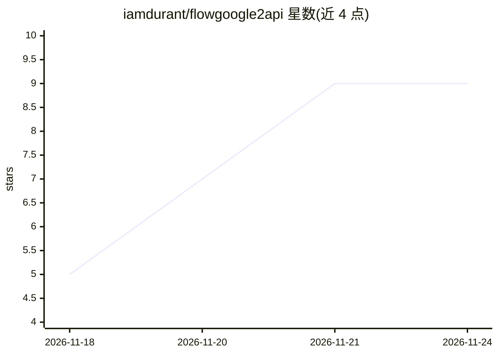

# iamdurant/flowgoogle2api

⭐ 9 · TypeScript · MIT · 推送 2026-11-17 · [GitHub](https://github.com/iamdurant/flowgoogle2api) · 个人维护 · 中文 README

**把 Google Flow 图像生成/编辑封装为 OpenAI 兼容 API**

以 Playwright 驱动 Chrome 在 Google Flow 网页内调用其接口，对外提供 /v1/images/generations、/v1/images/edits 与 /v1/chat/completions 等 OpenAI 兼容端点，模型名映射到 nano-banana 系列，默认输出 2K、失败降级 1K。支持多账号轮换（每账号隔离 BrowserContext 与多个 worker 标签页）、串行预热斜坡规避风控、/admin 管理台热增删账号与查看请求日志。为非官方逆向项目，上游接口可能变更，使用可能违反 Google 服务条款。

## 筛选速览

| 维度 | 判定 | 备注 |
|---|---|---|
| AI 角色 | `ai-ecosystem` | LLM/agent 周边工具 |
| 许可风险 | `permissive` | MIT |
| 部署形态 | `self-host` | docker 或自建部署 |
| 模型依赖 | — | README 未给出锁定关系 |
| 硬件要求 | — | 无带数字的原话,不猜 |
| 安装摩擦 | `low` | 无编译、无系统依赖或容器化 |
| 成熟度 | — | 结构信号不足 |

## 能力要点

- OpenAI 兼容端点：generations/edits/chat/completions，支持 SSE 流式
- 多账号轮换与 cookie 自动合并落盘，避免轮换过期
- 预热斜坡串行铺满标签页后再放开并发，规避账号级风控
- 内置 /admin 管理台：账号热增删改、成功/失败计数、请求日志

## 适用场景

- 把 Flow 出图接入已按 OpenAI API 格式调用的工作流
- 多账号池提高图像生成总并发
- 通过管理台集中维护账号 cookie 与排查失败请求

## 场景标签

`图像生成` · 领域:内容生成

## 证据(README 行号)

> L3: 把 Google Flow 的图像生成与编辑能力封装成 OpenAI 兼容 API。默认输出 2K，支持多账号轮换，自带账号管理台与请求日志。
> L9: - **OpenAI 兼容**：`/v1/models`、`/v1/images/generations`、`/v1/images/edits`、`/v1/chat/completions`
> L26: 上游调用全部发生在标签页内：`jHPbke` 建项目、`ogiZ0b` 生成/编辑、`SPrCad` 2K 重塑、`as29s` 保存媒体、`QI2zvc` 收尾。比例是 `ogiZ0b` 请求体里的枚举字段。reCAPTCHA 

## 星数曲线

2026-11-18 5 → 2026-11-24 9（+4）

---
*卡片 v1 · prompt 1.4 · 生成 2026-11-20 · 置信度 high · 依据 README sha `dd0c2ce2e61d` · [字段定义](../../DATASET.md)*
