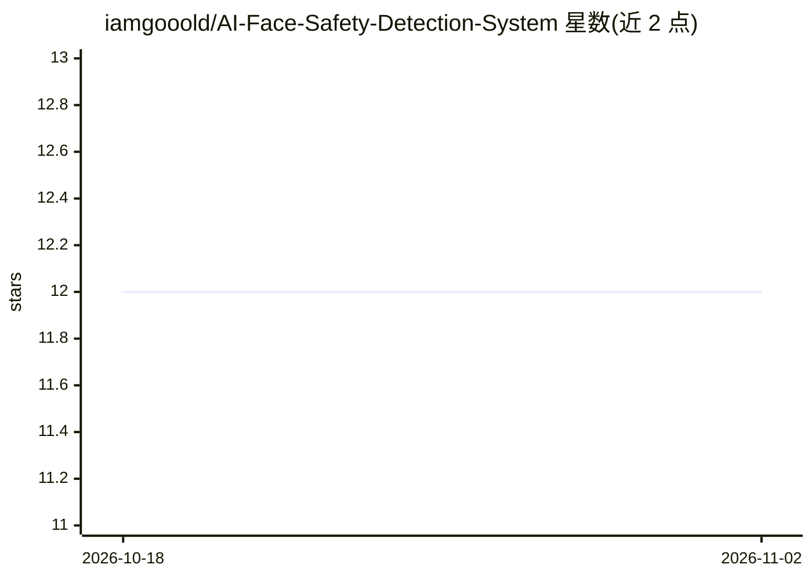

# iamgooold/AI-Face-Safety-Detection-System

⭐ 12 · Python · 推送 2026-03-26 · [GitHub](https://github.com/iamgooold/AI-Face-Safety-Detection-System) · 个人维护

**实时清醒度与安全危害检测的微服务系统（摄像头/图像分类）**

基于 FastAPI 的微服务式 AI 分类系统，使用计算机视觉对实时视频流或静态图像进行检测，返回分类标签、置信度与推理耗时。功能包括摄像头流实时推理、图像上传分析端点（POST /predict/image、GET /predict/stream、/health 健康检查）以及解耦的 API/模型/前端分层架构。模型基于 TensorFlow（.h5），未提供训练模型时可运行脚本生成演示模型。提供 pip 依赖安装与 Docker 镜像构建两种部署方式，UI 运行于 localhost:8000。以 Apache 2.0 许可发布。

## 筛选速览

| 维度 | 判定 | 备注 |
|---|---|---|
| AI 角色 | `ai-native` | 本体是模型或模型工具 |
| 许可风险 | `none` | — |
| 部署形态 | `self-host` | docker 或自建部署 |
| 模型依赖 | — | README 未给出锁定关系 |
| 硬件要求 | — | 无带数字的原话,不猜 |
| 安装摩擦 | `low` | 无编译、无系统依赖或容器化 |
| 成熟度 | — | 结构信号不足 |

## 能力要点

- 摄像头流与静态图像双通道实时分类，返回标签+置信度+推理耗时
- FastAPI 微服务架构，API/模型/前端分层
- 提供 Docker 镜像一键部署
- 内置生成演示 .h5 模型的脚本

## 适用场景

- 通过摄像头实时监控清醒度或安全隐患
- 上传静态图片做安全分类分析
- 作为独立微服务接入既有安防系统

## 场景标签

`网络安全` `目标检测` · 领域:学习与行业

## 证据(README 行号)

> L19: A microservice-based AI classification system that detects sobriety and safety hazards in real time using computer 
> L27: |**Live Webcam Inference**|Real-time video stream classification|

## 星数曲线

2026-10-18 12 → 2026-11-02 12（+0）

---
*卡片 v1 · prompt 1.4 · 生成 2026-11-01 · 置信度 high · 依据 README sha `5f359c687b63` · [字段定义](../../DATASET.md)*
