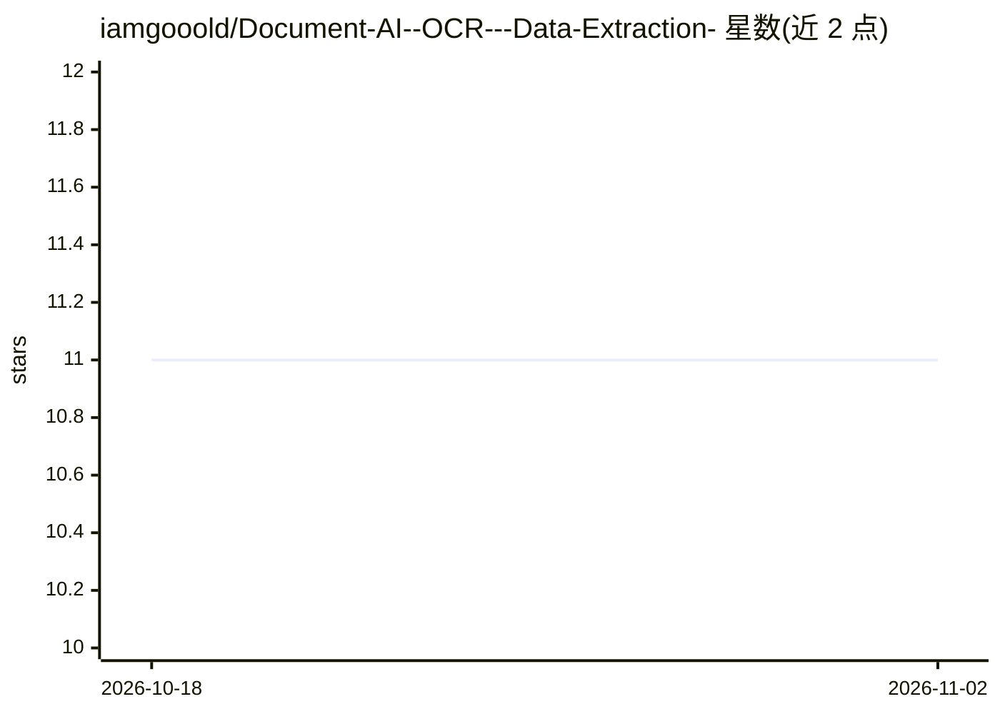

# iamgooold/Document-AI--OCR---Data-Extraction-

⭐ 11 · Python · MIT · 推送 2026-04-01 · [GitHub](https://github.com/iamgooold/Document-AI--OCR---Data-Extraction-) · 个人维护

**面向商业票据的 OCR 结构化数据提取 Web 应用**

基于 FastAPI 后端与 HTML5/JS 前端的文档处理应用：使用 PaddleOCR 对扫描发票、收据、表单（JPEG/PNG/PDF）做文本识别，自动抽取供应商名称、日期、总金额与行项目，结果可复制或导出为 JSON/Excel 供记账软件使用。安装方式为 git clone 源码、创建虚拟环境、pip 安装依赖后运行 python main.py，前端直接打开 index.html。OCR 引擎支持中文/英文/多语言。

## 筛选速览

| 维度 | 判定 | 备注 |
|---|---|---|
| AI 角色 | `ai-native` | 本体是模型或模型工具 |
| 许可风险 | `permissive` | MIT |
| 部署形态 | `library` | 以包/库形式分发 |
| 模型依赖 | — | README 未给出锁定关系 |
| 硬件要求 | — | 无带数字的原话,不猜 |
| 安装摩擦 | `low` | 无编译、无系统依赖或容器化 |
| 成熟度 | — | 结构信号不足 |

## 能力要点

- PaddleOCR 文本识别（中文/英文/多语言支持）
- 自动抽取供应商、日期、总额与行项目字段
- 支持 JPEG/PNG/PDF 输入，输出 JSON/Excel
- FastAPI 后端 + 原生 HTML5/JS 前端

## 适用场景

- 把发票和收据转成结构化数据，减少手工录入
- 报销流程中快速提取费用信息
- 将纸质单据数字化为可检索数据

## 场景标签

`OCR` `文档解析` · 领域:知识与检索

## 证据(README 行号)

> L6: **DocuScan AI** is a professional, AI-powered solution for extracting structured data from business documents. Built
> L9: - **AI-Powered OCR**: High-accuracy text extraction using state-of-the-art models (PaddleOCR).
> L24: - **OCR Engine**: PaddleOCR (High-accuracy Chinese/English/Multi-lang support)

## 星数曲线

2026-10-18 11 → 2026-11-02 11（+0）

---
*卡片 v1 · prompt 1.4 · 生成 2026-11-02 · 置信度 high · 依据 README sha `ef99ecf28605` · [字段定义](../../DATASET.md)*
