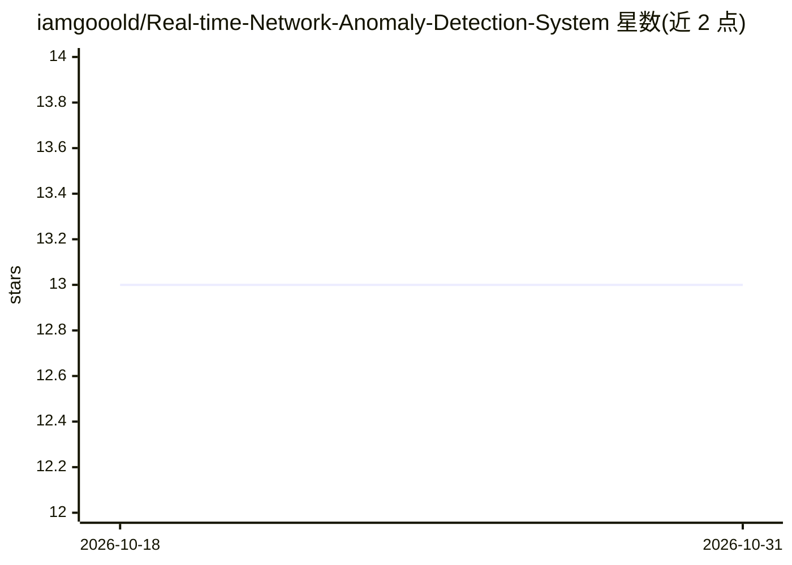

# iamgooold/Real-time-Network-Anomaly-Detection-System

⭐ 13 · Python · Apache-2.0 · 推送 2026-04-14 · [GitHub](https://github.com/iamgooold/Real-time-Network-Anomaly-Detection-System) · 个人维护

**实时网络流量异常检测系统：用机器学习识别网络威胁**

面向网络安全监控的实时异常检测框架：从网络流量中提取 IP 频率、登录失败率、会话时长、包大小、请求速率五类特征，用 Isolation Forest 与 PyTorch Autoencoder 组成的双层集成模型输出异常评分，可检测 DDoS、暴力破解、数据外泄等威胁模式。以 FastAPI 提供 REST 推理接口，Streamlit 提供实时监控面板，附带合成流量生成器用于训练与模拟攻击向量。通过 pip 安装依赖并运行 Python 脚本启动。

## 筛选速览

| 维度 | 判定 | 备注 |
|---|---|---|
| AI 角色 | `ai-native` | 本体是模型或模型工具 |
| 许可风险 | `permissive` | Apache-2.0 |
| 部署形态 | `library` | 以包/库形式分发 |
| 模型依赖 | — | README 未给出锁定关系 |
| 硬件要求 | — | 无带数字的原话,不猜 |
| 安装摩擦 | `low` | 无编译、无系统依赖或容器化 |
| 成熟度 | — | 结构信号不足 |

## 能力要点

- Isolation Forest + PyTorch Autoencoder 双层集成异常验证
- FastAPI 推理接口与 Streamlit 实时监控面板
- 合成流量生成器模拟正常活动与攻击向量
- 五类网络特征的自动化特征工程与标准化

## 适用场景

- 实时监控网络流量并发现 DDoS、暴力破解等攻击
- 通过 REST API 将异常检测接入现有安全系统
- 在仪表盘中可视化网络健康与异常评分

## 场景标签

`网络安全` · 领域:学习与行业

## 证据(README 行号)

> L3: A production-ready framework for monitoring network traffic and identifying anomalous patterns using an ensemble of 
> L7: - **Ensemble Detection Architecture**: Combines Scikit-learn's Isolation Forest with a PyTorch-based Autoencoder for

## 星数曲线

2026-10-18 13 → 2026-10-31 13（+0）

---
*卡片 v1 · prompt 1.4 · 生成 2026-10-31 · 置信度 mid · 依据 README sha `063ff17f003a` · [字段定义](../../DATASET.md)*
