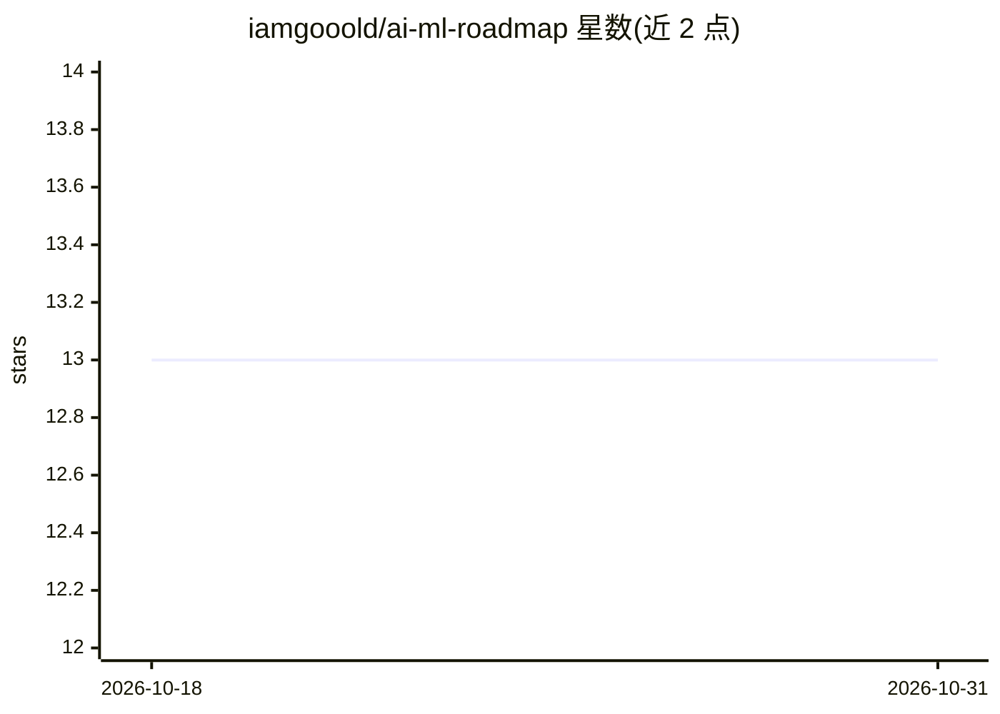

# iamgooold/ai-ml-roadmap

⭐ 13 · 推送 2026-01-02 · [GitHub](https://github.com/iamgooold/ai-ml-roadmap) · 个人维护

**面向学生与自学者的 AI/机器学习入门路线图**

一份从入门到中级的学习路线图，覆盖 Python 基础、ML 核心概念、计算机视觉基础、数据预处理、CNN 与 SVM 模型、模型评估、CNN–SVM 混合模型、数据集与伦理、论文与作品集准备共 9 个层级。每级列出学习目标、要点与常见错误，链接配套实践仓库 opencv-face-preprocessing，另有一个混合模型项目标注为即将推出。推荐工具包括 Python、OpenCV、TensorFlow、Scikit-learn 等。无安装运行方式，为纯文档型路线图。

## 筛选速览

| 维度 | 判定 | 备注 |
|---|---|---|
| AI 角色 | `ai-knowledge` | 知识聚合/清单类 |
| 许可风险 | `none` | — |
| 部署形态 | `None` |  |
| 模型依赖 | — | README 未给出锁定关系 |
| 硬件要求 | — | 无带数字的原话,不猜 |
| 安装摩擦 | `low` | 无编译、无系统依赖或容器化 |
| 成熟度 | — | 结构信号不足 |

## 能力要点

- 9 个层级结构化路径（Level 0-8）
- 每级含目标、要点与常见错误提示
- 链接配套实践仓库，含论文/作品集准备章节
- 给出推荐工具表（OpenCV/TensorFlow/Scikit-learn 等）

## 适用场景

- 按层级顺序自学 AI 与计算机视觉
- 为毕业论文或 capstone 项目规划技能准备
- 查漏补缺已有知识并找到实践项目

## 场景标签

`教程课程` · 领域:学习与行业

## 证据(README 行号)

> L2: Beginner → Intermediate (Student &amp; Self-Learner Friendly)
> L3: A practical, visual roadmap for learning AI & Machine Learning, focused on Computer Vision, real projects, and thesi

## 星数曲线

2026-10-18 13 → 2026-10-31 13（+0）

---
*卡片 v1 · prompt 1.4 · 生成 2026-10-31 · 置信度 high · 依据 README sha `61a999719bf1` · [字段定义](../../DATASET.md)*
