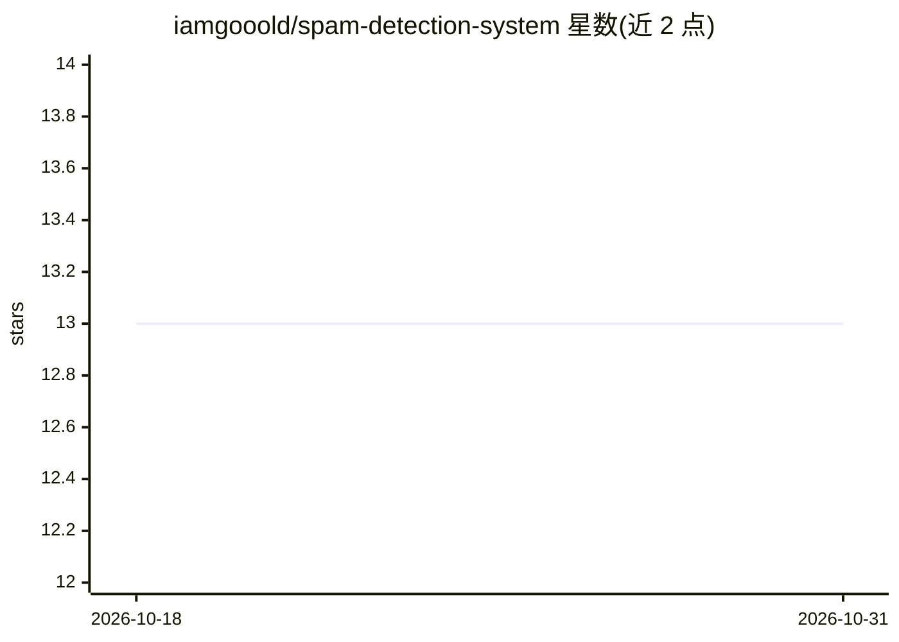

# iamgooold/spam-detection-system

⭐ 13 · Python · Apache-2.0 · 推送 2026-03-23 · [GitHub](https://github.com/iamgooold/spam-detection-system) · 个人维护

**基于 NLP 的短信垃圾消息分类应用，输出垃圾/正常判定与置信度**

使用 Python 与 TensorFlow/Keras 构建的短信文本垃圾检测应用：对输入消息进行 TF-IDF 向量化后经神经网络分类，输出 Spam/Ham 标签及概率化置信度分数，声明处理延迟低于 100ms；附 URL 检测与电话号码提取等特征处理。通过 Streamlit 提供 Web 界面（streamlit run app.py 启动），安装方式为克隆仓库并建立虚拟环境后安装依赖。README 报告准确率 98.2%、召回率 96.5% 等自测指标。

## 筛选速览

| 维度 | 判定 | 备注 |
|---|---|---|
| AI 角色 | `ai-native` | 本体是模型或模型工具 |
| 许可风险 | `permissive` | Apache-2.0 |
| 部署形态 | `None` |  |
| 模型依赖 | — | README 未给出锁定关系 |
| 硬件要求 | — | 无带数字的原话,不猜 |
| 安装摩擦 | `low` | 无编译、无系统依赖或容器化 |
| 成熟度 | — | 结构信号不足 |

## 能力要点

- TF-IDF 向量化 + TensorFlow/Keras 神经网络分类（输入维度 5000）
- 输出概率化置信度分数，声明 <100ms 处理延迟
- URL 检测与电话号码提取等垃圾消息模式处理
- Streamlit Web 界面运行（streamlit run app.py）

## 适用场景

- 对可疑短信做垃圾/正常判定并查看置信度
- 过滤含可疑链接的钓鱼或诈骗消息
- 在本地部署一个短信垃圾分类演示应用

## 场景标签

`网络安全` · 领域:学习与行业

## 证据(README 行号)

> L18: A **machine learning-powered application** that identifies spam messages using **Natural Language Processing (NLP)*
> L21: - Classifies text as **Spam** or **Ham** (legitimate)
> L41: - **Deep Learning Model** - TensorFlow/Keras neural network

## 星数曲线

2026-10-18 13 → 2026-10-31 13（+0）

---
*卡片 v1 · prompt 1.4 · 生成 2026-10-31 · 置信度 high · 依据 README sha `6afe47fdbf7e` · [字段定义](../../DATASET.md)*
