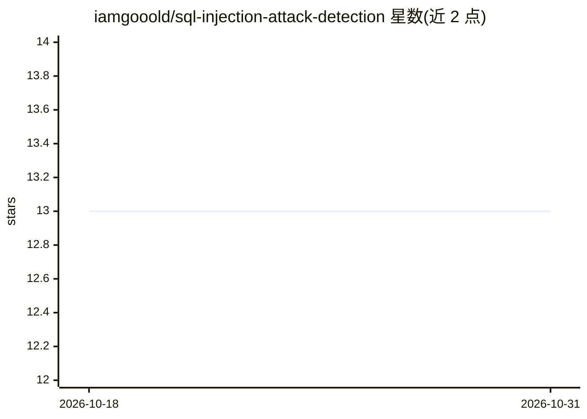

# iamgooold/sql-injection-attack-detection

⭐ 13 · Python · Apache-2.0 · 推送 2026-05-15 · [GitHub](https://github.com/iamgooold/sql-injection-attack-detection) · 个人维护

**基于 SVM 的 SQL 注入检测系统：判定查询是否恶意**

面向安全学习与实践的 Python 项目：用 scikit-learn 训练 SVM 分类器识别恶意 SQL 查询，结合正则模式规则集与特征提取（OR/UNION 等模式）输出恶意判定、置信度、攻击类型与风险等级；另含故意含漏洞的 Flask 演示应用、攻击场景演示、参数化查询等安全编码示例，以及报告准确率 94.2% 的性能指标。训练依赖 MySQL 8.0+ 与 Python 3.8+，提供 pytest 测试。README 声明仅供教育与授权测试用途。

## 筛选速览

| 维度 | 判定 | 备注 |
|---|---|---|
| AI 角色 | `ai-native` | 本体是模型或模型工具 |
| 许可风险 | `permissive` | Apache-2.0 |
| 部署形态 | `None` |  |
| 模型依赖 | — | README 未给出锁定关系 |
| 硬件要求 | — | 无带数字的原话,不猜 |
| 安装摩擦 | `low` | 无编译、无系统依赖或容器化 |
| 成熟度 | — | 结构信号不足 |

## 能力要点

- SVM 分类器基于标注 SQL 查询数据集训练，报告准确率 94.2%
- 输出恶意判定、置信度、攻击类型（永真式/UNION/盲注等）与风险等级
- 含故意含漏洞的演示应用与攻击场景演示
- 提供参数化查询、ORM 等安全编码参考示例

## 适用场景

- 学习 SQL 注入漏洞原理与攻击向量
- 在自有系统上训练并测试 SQL 注入检测模型
- 通过 Flask Web 界面演示检测结果

## 场景标签

`网络安全` · 领域:学习与行业

## 证据(README 行号)

> L20: - SVM classifier trained on labeled SQL query patterns
> L52: python train_model.py --dataset data/sql_queries.csv --output models/detector.pkl
> L71: detector = SQLInjectionDetector(model_path='models/detector.pkl')

## 星数曲线

2026-10-18 13 → 2026-10-31 13（+0）

---
*卡片 v1 · prompt 1.4 · 生成 2026-10-31 · 置信度 high · 依据 README sha `c52cca1e163a` · [字段定义](../../DATASET.md)*
