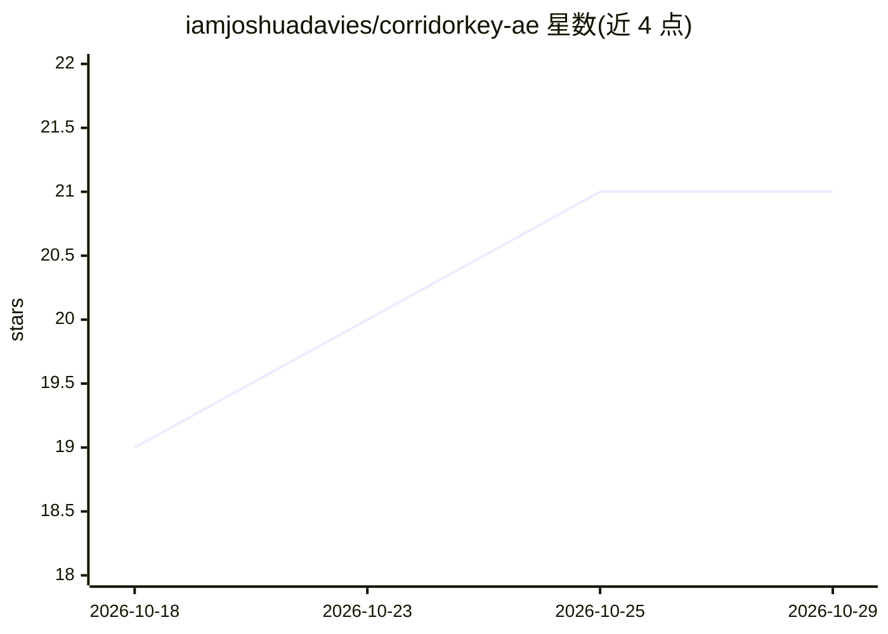

# iamjoshuadavies/corridorkey-ae

⭐ 21 · Python · NOASSERTION · 推送 2026-07-20 · [GitHub](https://github.com/iamjoshuadavies/corridorkey-ae) · [官网](https://github.com/iamjoshuadavies/corridorkey-ae/releases/latest) · 个人维护

**Adobe After Effects 本地 ML 绿幕抠像插件**

After Effects 原生抠像效果插件，面向影视合成工作者：内置色度键控器自动检测绿幕并生成 alpha 提示，驱动本地 ML 模型完成前景提取、despill 与 matte 清理，全程本地推理（macOS 用 MLX/Apple Silicon，Windows 用 PyTorch/CUDA），不联网、无订阅。安装器捆绑 Python 与依赖，模型权重约 398 MB 首帧下载后离线缓存。限制：不支持 Intel Mac、AMD/Intel GPU、CPU 推理与 Linux；安装包未签名。

## 筛选速览

| 维度 | 判定 | 备注 |
|---|---|---|
| AI 角色 | `ai-native` | 本体是模型或模型工具 |
| 许可风险 | `none` | NOASSERTION |
| 部署形态 | `desktop` | 安装包/桌面程序 |
| 模型依赖 | — | README 未给出锁定关系 |
| 硬件要求 | — | 无带数字的原话,不猜 |
| 安装摩擦 | `high` | 编译与系统依赖俱全 |
| 成熟度 | `idea` | |

## 能力要点

- 内置色度键控自动生成 alpha 提示，免手动设置
- 本地推理：MLX（Apple Silicon）/ PyTorch+CUDA（Windows），数据不出本机
- 原生 AE 效果：Smart Render、多帧渲染、8/16/32bpc、分块全分辨率输出
- 4 档质量预设与两层帧缓存，后期参数调整无需重跑模型

## 适用场景

- 在 AE 中对绿幕素材做一键高质量抠像
- 预览管线各阶段（Alpha Hint/Matte/Foreground/Composite）检查结果
- 需要数据不出本机的离线合成流程

## 场景标签

`图像视频处理` · 领域:感知与多模态

## 证据(README 行号)

> L30: CorridorKey AE brings physically accurate green-screen separation directly
> L177: - **Local inference** — MLX on Apple Silicon, PyTorch/CUDA on Windows. Nothing leaves your machine.

## 星数曲线

2026-10-18 19 → 2026-10-29 21（+2）

---
*卡片 v1 · prompt 1.4 · 生成 2026-10-28 · 置信度 high · 依据 README sha `fd92e1e7320d` · [字段定义](../../DATASET.md)*
