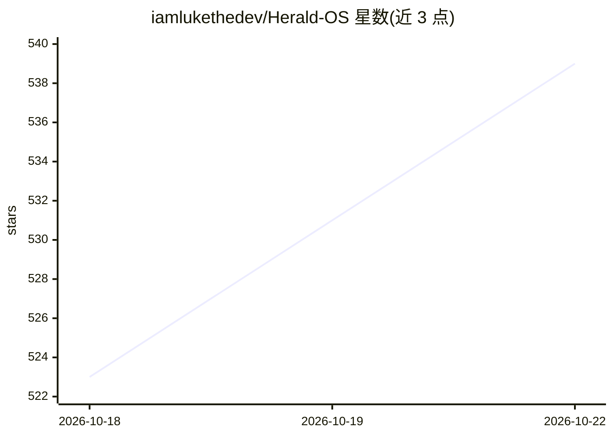

# iamlukethedev/Herald-OS

⭐ 542 · TypeScript · MIT · 推送 2026-10-20 · [GitHub](https://github.com/iamlukethedev/Herald-OS) · 个人维护

**以 AI agent 为交互界面的操作系统（macOS/Linux）**

个人开发者 Luke The Dev 的独立项目，非 Nous Research 官方产品。整个桌面环境围绕 Hermes Agent 构建：用户通过语音或文字让 agent 打开应用、查找整理文件、监控运行状态、按计划执行例程、构建软件；所有改动性操作经过用户控制的权限系统。Linux 版基于 Fedora，支持 Arch/Omarchy/tarball 安装及 UTM/Hyper-V/QEMU 虚拟机，macOS 提供 dmg。模型提供方需 Nous Portal 或 API key（OpenRouter、OpenAI、Anthropic、本地模型等）。当前为 alpha (0.1)，README 提示保留备份。

## 筛选速览

| 维度 | 判定 | 备注 |
|---|---|---|
| AI 角色 | `ai-native` | 本体是模型或模型工具 |
| 许可风险 | `permissive` | MIT |
| 部署形态 | `desktop` | 安装包/桌面程序 |
| 模型依赖 | — | README 未给出锁定关系 |
| 硬件要求 | — | 无带数字的原话,不猜 |
| 安装摩擦 | `low` | 无编译、无系统依赖或容器化 |
| 成熟度 | `idea` | |

## 能力要点

- agent 负责开应用、找文件、跑例程、构建软件，操作经权限系统
- Linux 版基于 Fedora，提供安装 ISO、Arch 包、tarball 与 UTM/Hyper-V 虚拟机
- 模型提供方可切换：Nous Portal、OpenRouter、OpenAI、Anthropic、本地模型及自定义 endpoint
- 整系统更新：herald-os update / rollback

## 适用场景

- 用对话代替菜单操作整台电脑
- 在虚拟机中试用整套 agent 操作系统
- 在 Arch/Omarchy 桌面内以应用形式运行 Herald OS

## 场景标签

`GUI 自动化` `AI 助手` · 领域:效率与自动化

## 证据(README 行号)

> L14: Herald OS is an operating system built around an AI agent. Instead of working through menus and
> L15: folders yourself, you talk or type to Hermes, and it works across the whole machine: it opens apps,
> L45: Hermes needs a model provider whichever you pick: a Nous Portal

## 星数曲线

2026-10-18 523 → 2026-10-22 539（+16）

---
*卡片 v1 · prompt 1.4 · 生成 2026-10-21 · 置信度 high · 依据 README sha `50acee1516fc` · [字段定义](../../DATASET.md)*
