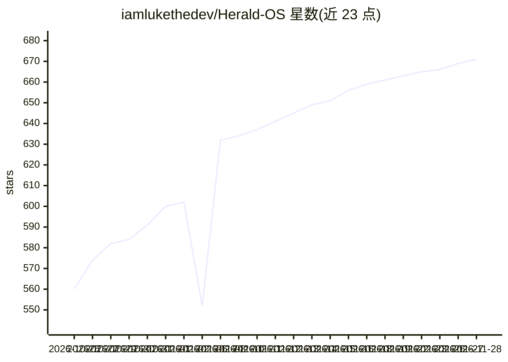

# iamlukethedev/Herald-OS

⭐ 671 · TypeScript · MIT · 推送 2026-11-27 · [GitHub](https://github.com/iamlukethedev/Herald-OS) · 个人维护

**以 Hermes Agent 为交互界面的 agent 原生操作系统**

Herald OS 是围绕 AI agent 构建的操作系统：用户通过语音或文字与 Hermes Agent 交互，由其操作整台机器——打开应用、查找整理文件、监控运行进程、按计划执行例程、构建软件，所有更改性操作经由用户可控的权限系统。分发形式包括 macOS dmg 安装包、基于 Fedora 的 PC 整机 ISO、Arch 包、Omarchy 集成、tarball 与虚拟机磁盘。状态为 alpha（0.1），macOS 构建未经 Apple 公证，Intel 版与部分虚拟机磁盘尚未发布。独立项目，与 Nous Research 无隶属关系。

## 筛选速览

| 维度 | 判定 | 备注 |
|---|---|---|
| AI 角色 | `ai-native` | 本体是模型或模型工具 |
| 许可风险 | `permissive` | MIT |
| 部署形态 | `desktop` | 安装包/桌面程序 |
| 模型依赖 | — | README 未给出锁定关系 |
| 硬件要求 | — | 无带数字的原话,不猜 |
| 安装摩擦 | `low` | 无编译、无系统依赖或容器化 |
| 成熟度 | `idea` | |

## 能力要点

- 以 Hermes Agent 作为系统级交互界面，跨整台机器执行操作
- 所有更改性操作经由用户可控的权限系统
- 多种分发形态：macOS dmg、Fedora 整机 ISO、Arch 包、Omarchy、tarball、虚拟机磁盘
- herald-os update/rollback 提供系统级更新与回滚

## 适用场景

- 把一台 PC 装成由 agent 驱动的专用操作系统
- 在现有 Arch/Omarchy 桌面里以应用或会话形式运行 Herald
- 用虚拟机在 Mac 上试用完整系统

## 场景标签

`AI 助手` `GUI 自动化` · 领域:效率与自动化

## 证据(README 行号)

> L14: Herald OS is an operating system built around an AI agent. Instead of working through menus and
> L24: > the open-source agent Nous Research publishes, which is installed alongside it.

## 星数曲线

2026-10-26 560 → 2026-11-28 671（+111）

---
*卡片 v1 · prompt 1.4 · 生成 2026-11-24 · 置信度 high · 依据 README sha `058cfc0211b5` · [字段定义](../../DATASET.md)*
