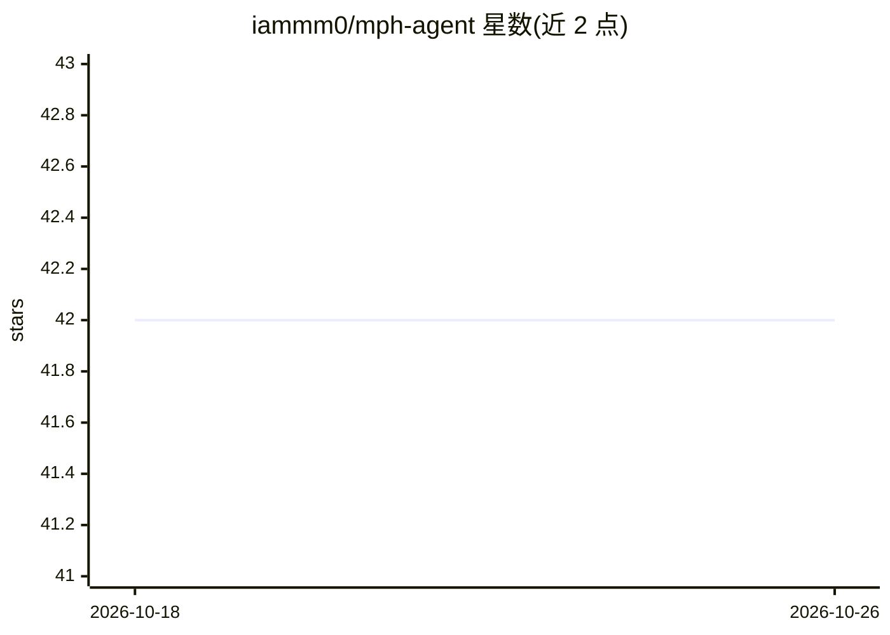

# iammm0/mph-agent

⭐ 42 · Python · NOASSERTION · 推送 2026-09-18 · [GitHub](https://github.com/iammm0/mph-agent) · [官网](https://mphagent.site) · 个人维护 · 中文 README

**把自然语言转成 COMSOL 可打开 .mph 文件的建模智能体**

面向 COMSOL Multiphysics 6.3 的开源建模智能体：用户在桌面应用或 CLI 中用自然语言描述几何、材料、物理场、网格、研究与求解，Agent 规划步骤并调用本机已授权的 COMSOL Java API，分阶段写出可追踪的 .mph 文件。支持 /discuss、/plan 等模式，LLM 后端可选 DeepSeek、Kimi、Ollama 或 OpenAI 兼容接口。需本机安装正版 COMSOL 6.3，官方测试范围为 Windows x64 与 macOS Apple Silicon；与 COMSOL 官方无关联。

## 筛选速览

| 维度 | 判定 | 备注 |
|---|---|---|
| AI 角色 | `ai-native` | 本体是模型或模型工具 |
| 许可风险 | `permissive` | NOASSERTION |
| 部署形态 | `None` |  |
| 模型依赖 | local-ok | 支持本地模型 |
| 硬件要求 | — | 无带数字的原话,不猜 |
| 安装摩擦 | `medium` | 含编译或系统依赖之一 |
| 成熟度 | — | 结构信号不足 |

## 能力要点

- 自然语言生成几何、材料、物理场、网格、研究与求解
- 调用本机 COMSOL Java API，每阶段单独保存 .mph
- 桌面安装包内置 Java 11，无需另装 Python 或 JDK
- 可选导入本机 COMSOL 文档为本地知识库

## 适用场景

- 用自然语言快速搭建多物理场仿真模型
- 分阶段生成 .mph 文件，便于回看和排错
- 在讨论/计划模式确认后再执行建模操作

## 场景标签

`代码生成` · 领域:编码与开发

## 证据(README 行号)

> L15: mph-agent 是面向 **COMSOL Multiphysics 6.3** 的开源建模智能体。在桌面应用里用自然语言描述几何、材料、物理场和研究，它会规划步骤、调用本机已授权的 COMSOL Java API，并按阶段写出
> L33: - 用自然语言生成几何、材料、物理场、网格、研究和求解

## 星数曲线

2026-10-18 42 → 2026-10-26 42（+0）

---
*卡片 v1 · prompt 1.4 · 生成 2026-10-25 · 置信度 high · 依据 README sha `f30ad655bab3` · [字段定义](../../DATASET.md)*
