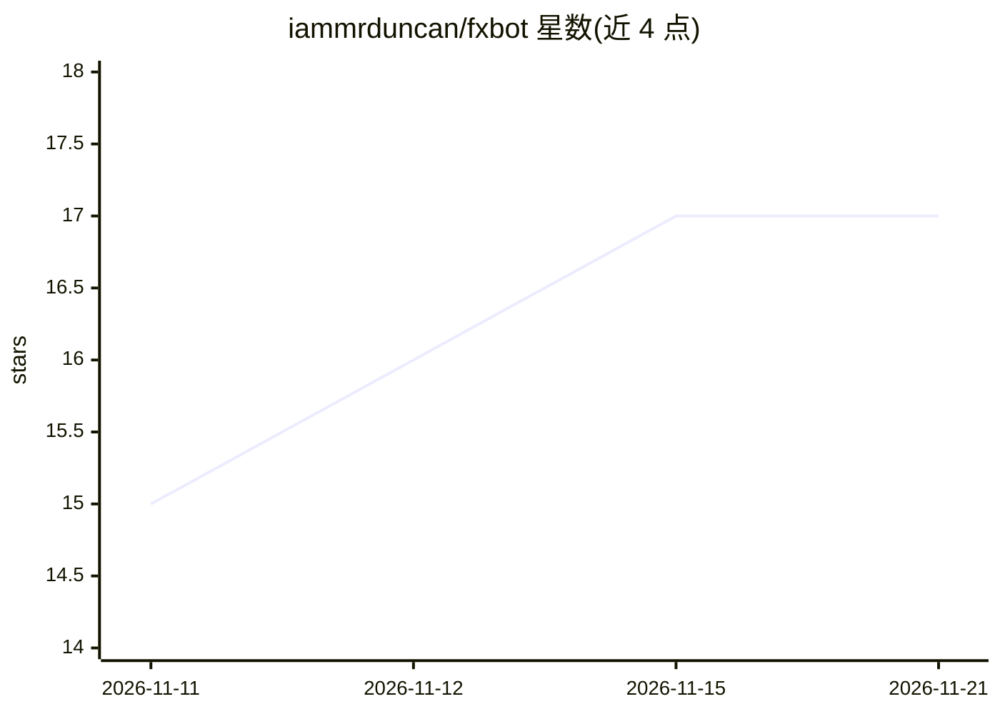

# iammrduncan/fxbot

⭐ 17 · JavaScript · Apache-2.0 · 推送 2026-11-15 · [GitHub](https://github.com/iammrduncan/fxbot) · [官网](https://fxbot.sh) · 个人维护

**自托管的个人 AI 助手平台：任意模型、自有机器、手机访问**

运行在用户自己机器上的 AI 助手框架：创建多个 bot，各自可选用不同模型（ChatGPT/Grok/OpenRouter 登录，Claude/Gemini 等 API key，或 Ollama/LM Studio 本地模型），具备聊天、持久记忆、定时任务、子代理、聊天室与跨 bot 协作。插件系统提供每 bot 独立 Linux 计算机（podman/docker 无根容器）、可被接管操作的桌面与浏览器、页面生成、WebRTC 网页配对从手机访问等。技术栈为 TypeScript monorepo（四个 npm workspace），Node 22.18+ 与 Postgres 运行在本机，浏览器/PWA 作为 UI。部分功能（Claude 原生 API、桌面分发、Telegram/Discord 网关等）仍在路线图未完成。

## 筛选速览

| 维度 | 判定 | 备注 |
|---|---|---|
| AI 角色 | `ai-native` | 本体是模型或模型工具 |
| 许可风险 | `permissive` | Apache-2.0 |
| 部署形态 | `library` | 以包/库形式分发 |
| 模型依赖 | local-ok | 支持本地模型 |
| 硬件要求 | — | 无带数字的原话,不猜 |
| 安装摩擦 | `low` | 无编译、无系统依赖或容器化 |
| 成熟度 | — | 结构信号不足 |

## 能力要点

- 每 bot 独立选择模型，支持约 30+ 提供商登录/API key 及 Ollama、LM Studio 本地模型
- 插件系统：bot 专属 Linux 计算机（无根容器）、桌面接管、子代理、定时任务、聊天室
- WebRTC 网页配对，从手机或任意浏览器访问自托管实例，无需 VPN
- 核心+插件架构，单 compose 文件部署 fxbot 与 pgvector 数据库

## 适用场景

- 在自己机器上运行多个 AI 个人助手并从手机对话
- 让 bot 在专属容器计算机里定时或后台执行任务
- 组建多个 bot 协作的聊天室完成复杂工作

## 场景标签

`AI 助手` `多智能体` `工作流自动化` · 领域:Agent 开发

## 证据(README 行号)

> L5: fxbot is AI assistants that do real work, built your way. Each one chats, remembers, works on a computer of its own,
> L7: - **Any model.** Sign in with ChatGPT, Grok, or OpenRouter, add a key for Claude, Gemini, or about 30 others, or run

## 星数曲线

2026-11-11 15 → 2026-11-21 17（+2）

---
*卡片 v1 · prompt 1.4 · 生成 2026-11-18 · 置信度 mid · 依据 README sha `b9ba4314c988` · [字段定义](../../DATASET.md)*
