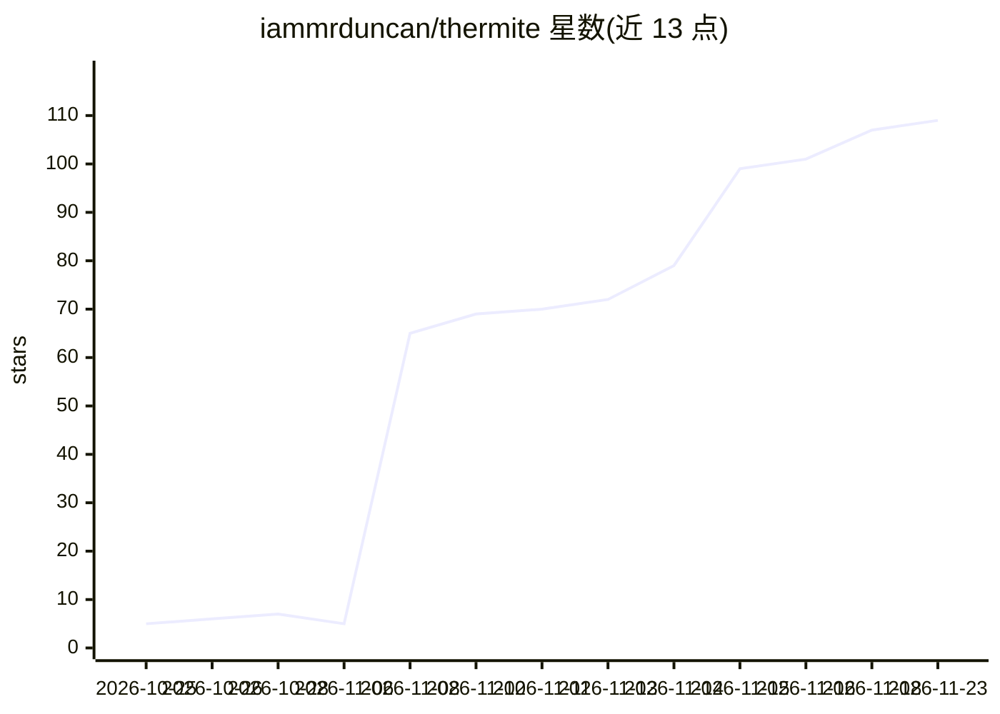

# iammrduncan/thermite

⭐ 109 · TypeScript · Apache-2.0 · 推送 2026-11-17 · [GitHub](https://github.com/iammrduncan/thermite) · [官网](https://usethermite.com) · 个人维护

**自主实验编排框架：AI agent 循环跑实验，独立 judge 裁决结果**

开源 autoresearch 编排系统：AI agent 在多车道上并行提出代码改动与实验方案，由 agent 无法读写的独立 judge 程序在同一硬件上构建、测量并验证每个改动，仅保留经确认的改进（champion），结果以补丁形式取回。支持三种模式（爬山/目标/研究），通过 dashboard、REST API 与 MCP 监控，可在本机、SSH GPU 机器、Kubernetes 或 RunPod 上运行。模型可选 OpenAI 兼容端点、Anthropic 或订阅；运行代码在用户机器上执行是已知安全限制。项目自述处于重度开发早期，建议锁定 tag 发布版安装。

## 筛选速览

| 维度 | 判定 | 备注 |
|---|---|---|
| AI 角色 | `ai-ecosystem` | LLM/agent 周边工具 |
| 许可风险 | `permissive` | Apache-2.0 |
| 部署形态 | `self-host` | docker 或自建部署 |
| 模型依赖 | — | README 未给出锁定关系 |
| 硬件要求 | — | 无带数字的原话,不猜 |
| 安装摩擦 | `low` | 无编译、无系统依赖或容器化 |
| 成熟度 | `idea` | |

## 能力要点

- agent 只提议，独立 judge 构建/测量/裁决，防止自我评分作弊
- 三种模式：Hill climb / Goal / Research，模式可组合
- docker compose/Podman 方式运行，本地到 Kubernetes/RunPod 多种部署
- dashboard + REST API + MCP 统一监控与操控所有机器上的 campaign

## 适用场景

- 让 AI agent 通宵自动优化内核/性能/精度等可量化指标
- 自动化满足一组构建与测试检查的移植或改造任务
- 带逐字引用核验的自动文献调研
- 管理跨多台机器的多个自主实验 campaign

## 场景标签

`科研工具` `Agent 框架` · 领域:Agent 开发

## 证据(README 行号)

> L5: Thermite is open-source **autoresearch**: AI agents that run experiments in a loop, for hours or days, on your own m
> L25: The hard part is trusting the results. An agent asked to make a number go up will sometimes make it only look highe
> L42: 2. **Agents try ideas side by side.** Each agent works in its own **lane**, on its own copy of the code. A stateles

## 星数曲线

2026-10-25 5 → 2026-11-23 109（+104）

---
*卡片 v1 · prompt 1.4 · 生成 2026-11-17 · 置信度 mid · 依据 README sha `924d7c5b172d` · [字段定义](../../DATASET.md)*
