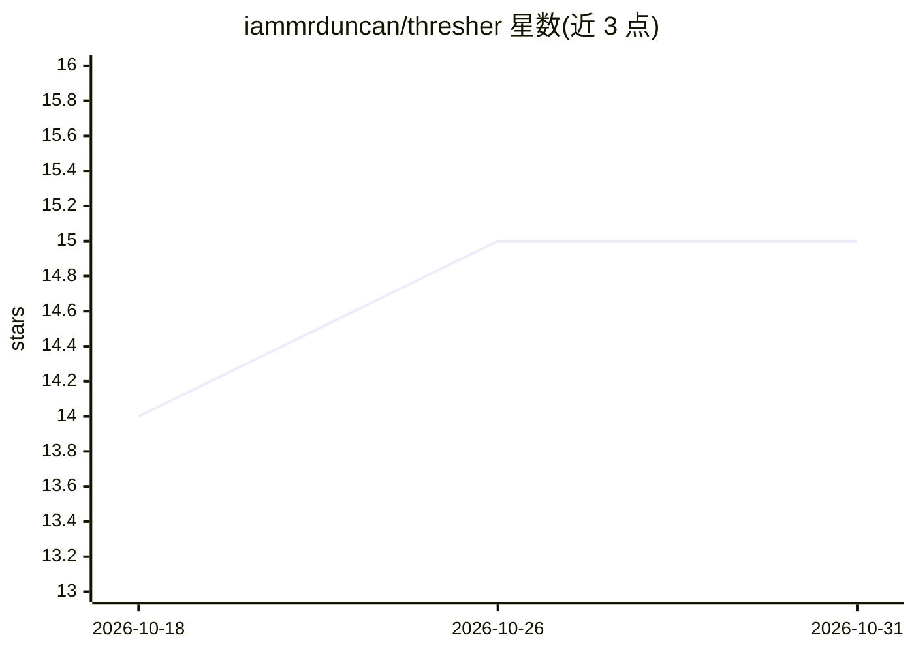

# iammrduncan/thresher

⭐ 15 · Python · MIT · 推送 2026-06-04 · [GitHub](https://github.com/iammrduncan/thresher) · [官网](https://thresher.sh) · 个人维护

**扫描开源项目供应链威胁的 AI 安全分析工具**

供应链安全扫描器：对 GitHub 仓库执行克隆、隐藏依赖发现、22 个确定性扫描器（SCA/SAST/熵分析/YARA/ClamAV/许可证等）与 8 个 Claude Code 无头 agent 分析师（对抗式验证降低误报），产出含 EPSS/KEV 加富的 Go/Caution/Do Not Use 报告。三种隔离模式：Lima+Docker（默认，macOS Apple Silicon）、Docker 容器、直连开发模式。声明为实验性版本，可通过 Homebrew 或 pip 安装，AI 部分需 ANTHROPIC_API_KEY（--skip-ai 可仅跑确定性扫描）。

## 筛选速览

| 维度 | 判定 | 备注 |
|---|---|---|
| AI 角色 | `ai-enhanced` | 去掉 AI 部分产品仍成立 |
| 许可风险 | `permissive` | MIT |
| 部署形态 | `self-host` | docker 或自建部署 |
| 模型依赖 | locked-api |  |
| 硬件要求 | — | 无带数字的原话,不猜 |
| 安装摩擦 | `low` | 无编译、无系统依赖或容器化 |
| 成熟度 | `idea` | |

## 能力要点

- 22 个确定性扫描器 + 8 个 AI 分析师并行调查
- 三级隔离：Lima+Docker VM / Docker 容器 / 直连，含 iptables 出站白名单与加固克隆
- EPSS/KEV 加富的分级报告（P0–Low）与 CycloneDX SBOM
- --skip-ai 标志可仅运行确定性扫描器

## 适用场景

- 引入第三方开源依赖前做供应链安全审查
- 检测仓库中的恶意代码、后门与凭据泄露
- 生成 Go/Caution/Do Not Use 采用建议与 SBOM 供合规留档

## 场景标签

`网络安全` · 领域:学习与行业

## 证据(README 行号)

> L12: Supply chain security scanner. 22 deterministic scanners + 8 AI analyst personas inside a hardened container. Three
> L55: |**Analyze**|8 AI personas investigate in parallel. Adversarial verification reduces false positives.|
> L133: |`--skip-ai`|off|Deterministic scanners only|

## 星数曲线

2026-10-18 14 → 2026-10-31 15（+1）

---
*卡片 v1 · prompt 1.4 · 生成 2026-10-30 · 置信度 high · 依据 README sha `b932bc077487` · [字段定义](../../DATASET.md)*
