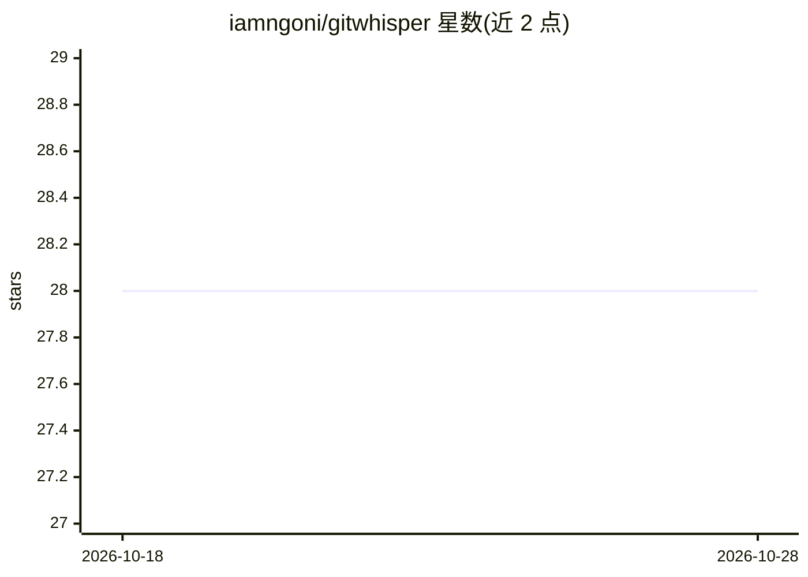

# iamngoni/gitwhisper

⭐ 28 · Dart · MIT · 推送 2026-10-14 · [GitHub](https://github.com/iamngoni/gitwhisper) · [官网](https://iamngoni.github.io/gitwhisper/) · 个人维护

**面向开发者的 AI Git 提交信息生成器**

用 Dart 编写的命令行工具（别称 gw）：读取 staged 变更，调用多种 AI 模型（Anthropic/Claude Code 本地认证/OpenAI/Gemini/Grok/DeepSeek/Ollama 等）生成符合 conventional commit 格式的提交信息，支持交互确认、编辑、换模型重试、自动推送、打标签、多语言消息与 dry-run。analyze 子命令可分析变更并给改进建议。ACP agent 模式下向模型暴露只读 git 工具（diff/blame/搜索），且有 agent 白名单、审批与缓存机制。另有 VS Code 扩展与 JetBrains 插件。

## 筛选速览

| 维度 | 判定 | 备注 |
|---|---|---|
| AI 角色 | `ai-native` | 本体是模型或模型工具 |
| 许可风险 | `permissive` | MIT |
| 部署形态 | `None` |  |
| 模型依赖 | local-ok | 支持本地模型 |
| 硬件要求 | — | 无带数字的原话,不猜 |
| 安装摩擦 | `low` | 无编译、无系统依赖或容器化 |
| 成熟度 | — | 结构信号不足 |

## 能力要点

- 读取 staged 变更生成 conventional commit 格式提交信息，支持交互确认与多模型重试
- 支持多种 API 模型与 Ollama 本地模型，以及 Codex/Claude Code 本地认证
- ACP agent 模式：模型通过只读 git 工具（diff/blame/搜索）检查变更，含 agent 审批与缓存机制
- 提供 VS Code 扩展与 JetBrains 插件

## 适用场景

- 提交前自动生成规范化 commit message
- 用本地模型（Ollama）生成提交信息
- 让 AI 分析代码变更并获得改进建议

## 场景标签

`代码生成` · 领域:编码与开发

## 证据(README 行号)

> L9: Git Whisper is an AI-powered Git commit message generator that whispers the perfect commit message based on your sta
> L80: - 🤖 Leverages various AI models to analyze your code changes and generate meaningful commit messages
> L94: - 🔌 Supports multiple AI models:

## 星数曲线

2026-10-18 28 → 2026-10-28 28（+0）

---
*卡片 v1 · prompt 1.4 · 生成 2026-10-26 · 置信度 high · 依据 README sha `90bc4db9fdcc` · [字段定义](../../DATASET.md)*
