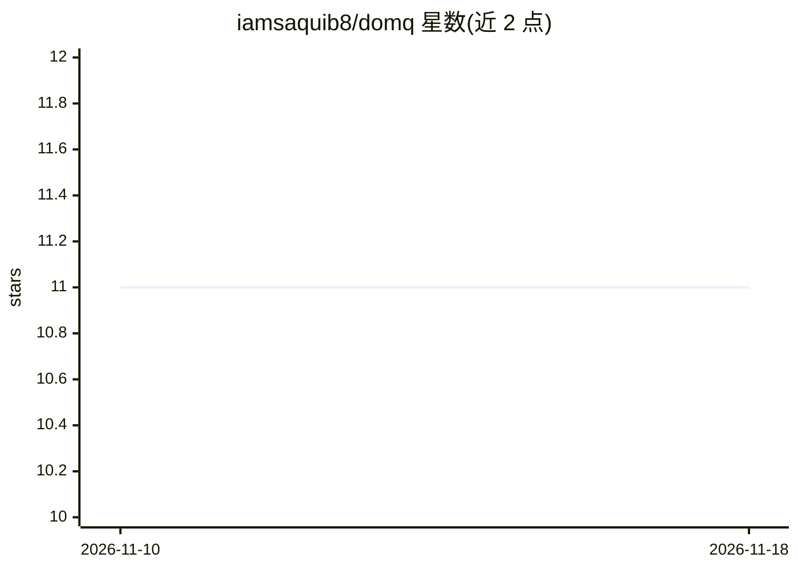

# iamsaquib8/domq

⭐ 11 · Rust · MIT · 推送 2026-11-09 · [GitHub](https://github.com/iamsaquib8/domq) · [官网](https://iamsaquib8.github.io/domq/) · 个人维护

**多语言零依赖 HTML 解析器：输入混乱 HTML，输出树/文本/Markdown/JSON**

以 Rust 库、CLI、WASM（npm）与 Python 包四种形态提供同一解析引擎：CSS 选择器查询、文本/Markdown/JSON/CSV 输出、reader 模式提取、RAG 分块、编码检测、outline 与可访问性 lint。零依赖、禁止 panic、支持 no_std，并提供 MCP 服务器（domq mcp）供 Claude Code、Cursor 等客户端将 HTML 转为 Markdown/字段/链接。0.4 起由 dom-tree-rs 等旧包更名而来。

## 筛选速览

| 维度 | 判定 | 备注 |
|---|---|---|
| AI 角色 | `ai-enhanced` | 去掉 AI 部分产品仍成立 |
| 许可风险 | `permissive` | MIT |
| 部署形态 | `library` | 以包/库形式分发 |
| 模型依赖 | — | README 未给出锁定关系 |
| 硬件要求 | — | 无带数字的原话,不猜 |
| 安装摩擦 | `low` | 无编译、无系统依赖或容器化 |
| 成熟度 | — | 结构信号不足 |

## 能力要点

- Rust 库/CLI/WASM/Python 四种入口共享同一引擎
- CSS 选择器、Markdown/JSON/CSV 输出、reader 模式与 RAG 分块
- domq mcp 以 MCP 服务器形式向 agent 暴露只读工具
- 零依赖、#![forbid(unsafe_code)]、no_std 兼容

## 适用场景

- 在 shell 管道中用 CSS 选择器抓取网页标题、链接、价格
- 把网页正文转成 Markdown 喂给 LLM 或 RAG 管线
- 为 MCP 客户端配置 HTML 处理工具
- 检查页面缺失 alt、重复 id 等无障碍问题

## 场景标签

`网页抓取` · 领域:效率与自动化

## 证据(README 行号)

> L3: A tiny, zero-dependency, never-panicking HTML parser with CSS selectors —
> L104: - **Agent-ready.** `domq mcp` is an MCP server, so Claude, Cursor or any MCP
> L246: `domq mcp` runs the CLI as a Model Context Protocol

## 星数曲线

2026-11-10 11 → 2026-11-18 11（+0）

---
*卡片 v1 · prompt 1.4 · 生成 2026-11-18 · 置信度 high · 依据 README sha `db1060f0bf88` · [字段定义](../../DATASET.md)*
