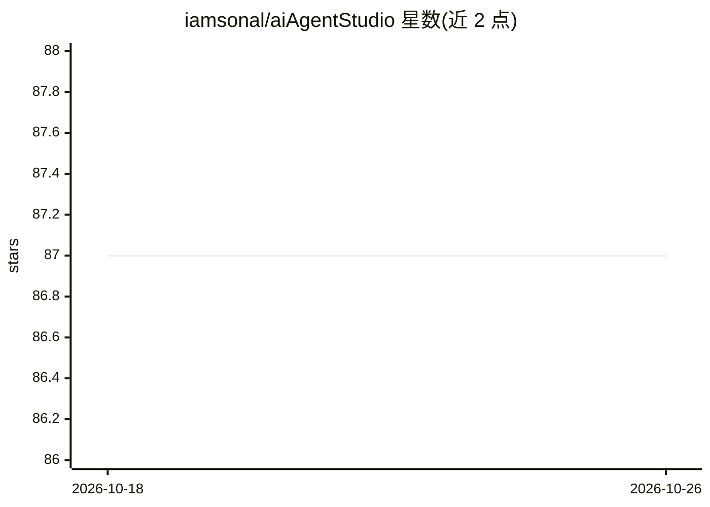

# iamsonal/aiAgentStudio

⭐ 87 · Apex · AGPL-3.0 · 推送 2026-10-15 · [GitHub](https://github.com/iamsonal/aiAgentStudio) · [官网](https://iamsonal.github.io/aiAgentStudio/) · 个人维护

**在 Salesforce 内运行 AI agent 的引擎（标准许可证）**

Pluto 是在 Salesforce 平台内运行 AI agent 的引擎套件，以解锁包（unlocked packages）安装，标准 Salesforce 许可证即可使用，模型提供商可选。Pluto Core 提供 agent 运行、工具调用、审批、恢复与数据保护；Pluto Model Adapters 提供 OpenAI 连接；Pluto Console 为管理员控制台。内置人工审批机制（agent 不自行批准变更）、敏感数据令牌化（邮件、电话、银行卡等）、运行上限（10 次模型调用/15 次工具调用/25 万 token）与 30 天数据清理。面向在 Salesforce 环境中构建和运营 agent 的开发者与管理员。

## 筛选速览

| 维度 | 判定 | 备注 |
|---|---|---|
| AI 角色 | `ai-ecosystem` | LLM/agent 周边工具 |
| 许可风险 | `viral` | AGPL-3.0 |
| 部署形态 | `None` |  |
| 模型依赖 | — | README 未给出锁定关系 |
| 硬件要求 | — | 无带数字的原话,不猜 |
| 安装摩擦 | `low` | 无编译、无系统依赖或容器化 |
| 成熟度 | — | 结构信号不足 |

## 能力要点

- Pluto Core 提供 agent 运行、工具、审批、恢复与数据保护
- 在 Salesforce 标准许可证上运行，任意模型提供商可选
- 人工审批机制：agent 不自行批准其变更
- 敏感数据（邮箱/电话/支付卡/SSN/IBAN）发送模型前替换为令牌
- 默认运行上限：10 次模型调用、15 次工具调用、250,000 tokens

## 适用场景

- 在 Salesforce 组织内构建并运行 AI agent
- 对 agent 的记录变更强制人工审批
- 控制模型调用成本并按 Agent Model 查看估算费用

## 场景标签

`Agent 框架` · 领域:Agent 开发

## 证据(README 行号)

> L5: Pluto runs AI agents inside Salesforce, on standard Salesforce licenses, with
> L10: |Pluto Core|The agent engine: runs, tools, approvals, recovery, and data protection|

## 星数曲线

2026-10-18 87 → 2026-10-26 87（+0）

---
*卡片 v1 · prompt 1.4 · 生成 2026-10-23 · 置信度 high · 依据 README sha `4819227bcc20` · [字段定义](../../DATASET.md)*
