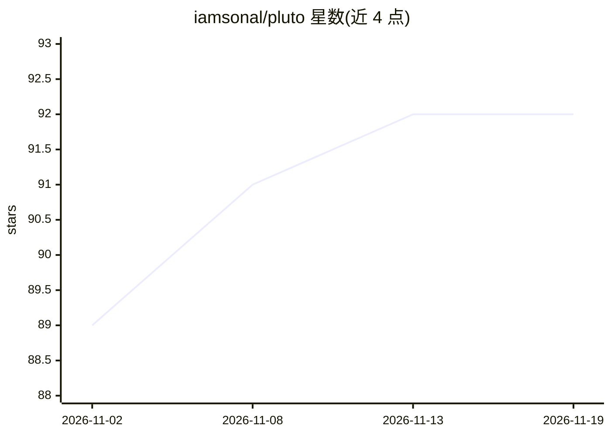

# iamsonal/pluto

⭐ 92 · Apex · AGPL-3.0 · 推送 2026-11-02 · [GitHub](https://github.com/iamsonal/pluto) · [官网](https://iamsonal.github.io/pluto/) · 个人维护

**在 Salesforce 内运行 AI agent 的引擎，支持任意模型供应商**

Pluto 在标准 Salesforce 许可证内运行 AI agent，核心包 Pluto Core 负责模型调用、工具执行、人工审批、运行恢复与数据保护，其余包（OpenAI 模型适配器、管理员控制台）均为可选。以 Salesforce unlocked package 形式安装，建议先在沙箱试用。安全机制包括：审批模式下 agent 不能自我批准、发送模型前对邮箱/电话/卡号/SSN 等敏感字段令牌化、运行默认限制（10 次模型调用/15 次工具调用/25 万 token）、30 天后清除运行数据。

## 筛选速览

| 维度 | 判定 | 备注 |
|---|---|---|
| AI 角色 | `ai-ecosystem` | LLM/agent 周边工具 |
| 许可风险 | `viral` | AGPL-3.0 |
| 部署形态 | `None` |  |
| 模型依赖 | — | README 未给出锁定关系 |
| 硬件要求 | — | 无带数字的原话,不猜 |
| 安装摩擦 | `low` | 无编译、无系统依赖或容器化 |
| 成熟度 | — | 结构信号不足 |

## 能力要点

- 在标准 Salesforce 许可证内运行 AI agent，无需额外 Salesforce 许可
- Pluto Core 提供模型调用、工具、审批、恢复与运行记录
- 发送模型前对敏感字段（邮箱/电话/卡号/SSN/IBAN/分级字段）令牌化
- 审批模式要求人工确认变更，agent 不能自我批准

## 适用场景

- 在 Salesforce 组织内构建并运行带工具调用能力的 AI agent
- 需要人工审批每一步变更的 CRM 自动化流程
- 对发送给模型的数据做脱敏与保留期管理

## 场景标签

`Agent 框架` `工作流自动化` · 领域:Agent 开发

## 证据(README 行号)

> L5: Pluto runs AI agents inside Salesforce, on standard Salesforce licenses, with
> L10: |Pluto Core|The agent engine: runs, tools, approvals, recovery, and data protection|

## 星数曲线

2026-11-02 89 → 2026-11-19 92（+3）

---
*卡片 v1 · prompt 1.4 · 生成 2026-11-17 · 置信度 high · 依据 README sha `e71c09537e34` · [字段定义](../../DATASET.md)*
