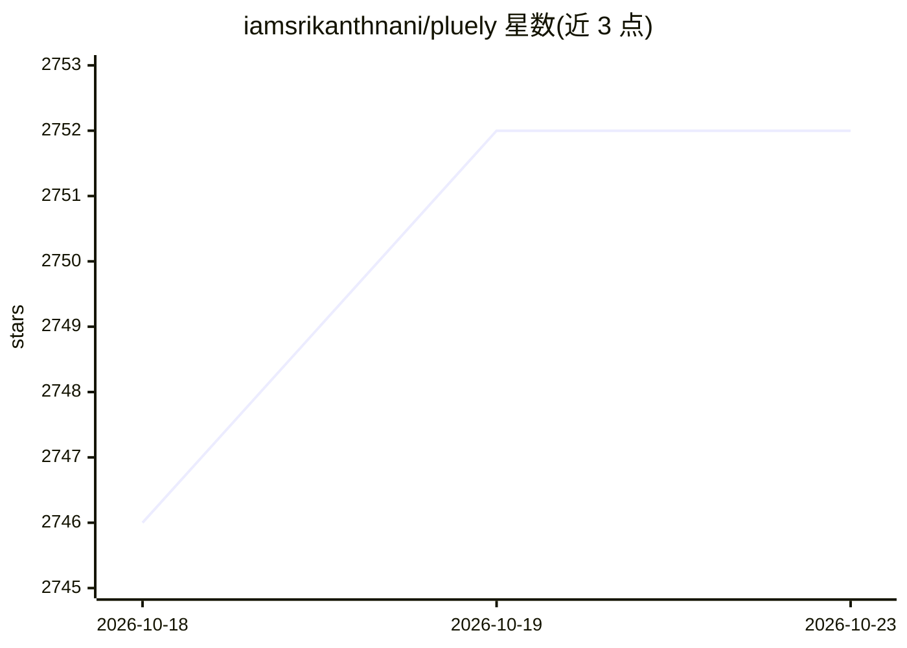

# iamsrikanthnani/pluely

⭐ 2,752 · TypeScript · GPL-3.0 · 推送 2026-09-21 · [GitHub](https://github.com/iamsrikanthnani/pluely) · [官网](https://pluely.com) · 个人维护

**桌面悬浮 AI 助手：会议/访谈中隐形提问与实时转录应答**

Tauri 构建的跨平台桌面悬浮 AI 助手，提供 Ask 与 Listen 两种模式：Ask 支持截图提问、OCR 文档与流式回答；Listen 实时转录麦克风与系统音频并按需自动生成回答。面向会议、面试、销售通话等不便切标签页的场景，内置对屏幕共享与录制的隐藏能力。数据存于本地 SQLite。v1 起闭源，仅发布签名二进制，核心免费；免费版可用自有 API key 或本地 CLI（Ollama、Claude Code 等），Pro 计划提供 200+ 托管模型。安装包 9-16MB。

## 筛选速览

| 维度 | 判定 | 备注 |
|---|---|---|
| AI 角色 | `ai-native` | 本体是模型或模型工具 |
| 许可风险 | `viral` | GPL-3.0 |
| 部署形态 | `desktop` | 安装包/桌面程序 |
| 模型依赖 | local-ok | 支持本地模型 |
| 硬件要求 | — | 无带数字的原话,不猜 |
| 安装摩擦 | `low` | 无编译、无系统依赖或容器化 |
| 成熟度 | — | 结构信号不足 |

## 能力要点

- Ask 模式支持截图/选区/文档 OCR 提问，回答流式输出并本地保存
- Listen 模式实时转录双声道音频、带说话人标签与自动建议回答
- 对屏幕共享、录制与截图隐藏，可隐藏 Dock/任务栏图标
- 免费版可接入自有 key 或本地 AI CLI（Ollama、Claude Code、Gemini CLI 等）

## 适用场景

- 会议或销售通话中实时获取转录与建议回答
- 面试或演讲时在不切窗口的情况下提问屏幕内容
- 调试时截图报错信息直接获得解答

## 场景标签

`AI 助手` `语音识别` · 领域:对话与助手

## 证据(README 行号)

> L24: > **Your invisible AI, over everything you do.** Ask about anything on your screen. Listen to any conversation and 
> L48: Pluely v1 is a ground-up rebuild: one translucent overlay with two modes, **Ask** and **Listen**, plus a full dashb
> L66: Hit Start and Pluely transcribes your mic and system audio live, with speaker labels and language selection. Automa

## 星数曲线

2026-10-18 2,746 → 2026-10-23 2,752（+6）

---
*卡片 v1 · prompt 1.4 · 生成 2026-10-21 · 置信度 high · 依据 README sha `df82998df7cd` · [字段定义](../../DATASET.md)*
