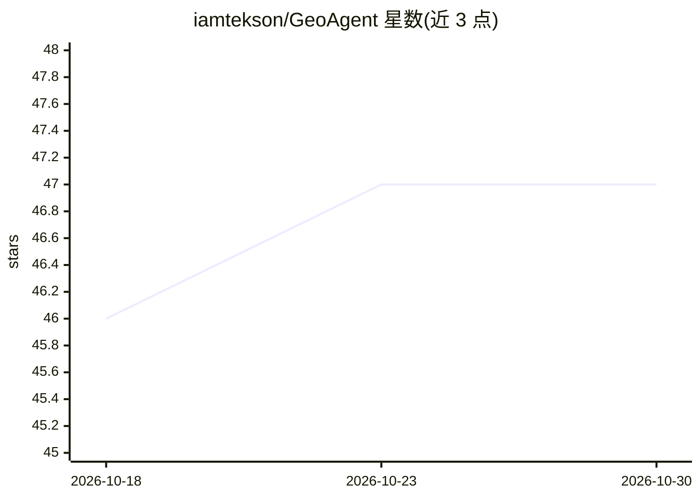

# iamtekson/GeoAgent

⭐ 47 · Python · MIT · 推送 2026-10-19 · [GitHub](https://github.com/iamtekson/GeoAgent) · [官网](https://plugins.qgis.org/plugins/geo_agent/) · 个人维护

**QGIS 插件：用自然语言驱动地理数据处理与分析**

以 QGIS 插件形式提供：用户用自然语言下指令，由 LLM 选取 QGIS 处理工具箱中的算法（native、GDAL、GRASS 等）、填充参数并执行，支持单步或多步链式处理，结果自动加入地图；可把一次运行导出为 QGIS 模型（.model3）。支持 Ollama（本地免费）、OpenAI、Gemini、Anthropic 作为 LLM 提供方，Logs 页记录每步参数与 token 消耗。面向 GIS 使用者与研究人员，附有 EarthArXiv 预印本引用。

## 筛选速览

| 维度 | 判定 | 备注 |
|---|---|---|
| AI 角色 | `ai-native` | 本体是模型或模型工具 |
| 许可风险 | `permissive` | MIT |
| 部署形态 | `None` |  |
| 模型依赖 | local-ok | 支持本地模型 |
| 硬件要求 | — | 无带数字的原话,不猜 |
| 安装摩擦 | `medium` | 含编译或系统依赖之一 |
| 成熟度 | — | 结构信号不足 |

## 能力要点

- 自然语言调用 QGIS 处理工具箱任意算法，支持多步链式执行
- 运行过程可导出为 QGIS 模型（.model3）复用
- 四种 LLM 后端可选：Ollama 本地运行或 OpenAI/Gemini/Anthropic
- Logs 页记录每步所用算法、参数与 token 消耗

## 适用场景

- 不懂算法细节也能用一句话完成缓冲区、裁剪、坡度计算等 GIS 分析
- 把自然语言分析流程固化为 QGIS 模型重复使用
- 在本地 Ollama 环境下做免 API key 的地理数据处理

## 场景标签

`数据分析` · 领域:效率与自动化

## 证据(README 行号)

> L5: GeoAgent is a QGIS plugin for geospatial analysis in plain language. Ask it to load data, explore your layers, or ru
> L16: - **Your choice of LLM** — Ollama (local and free), OpenAI, Google Gemini, or Anthropic Claude.

## 星数曲线

2026-10-18 46 → 2026-10-30 47（+1）

---
*卡片 v1 · prompt 1.4 · 生成 2026-10-25 · 置信度 high · 依据 README sha `0d541990e969` · [字段定义](../../DATASET.md)*
