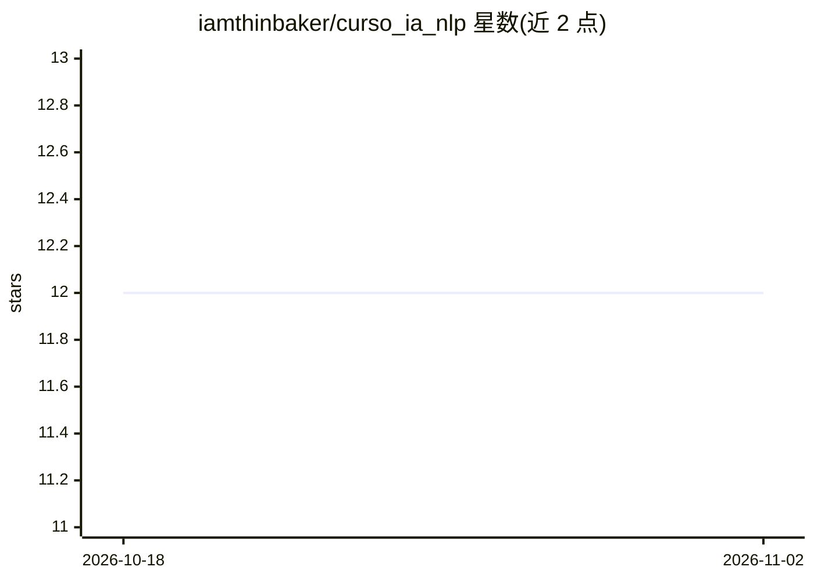

# iamthinbaker/curso_ia_nlp

⭐ 12 · Jupyter Notebook · MIT · 推送 2026-05-31 · [GitHub](https://github.com/iamthinbaker/curso_ia_nlp) · [官网](http://thinbaker.com/curso_ia_nlp/) · 个人维护

**面向非技术背景的 AI 与 NLP 实践教程（西语）**

一份实践手册式的课程仓库，以渐进路径讲解从经典机器学习（回归、监督/无监督学习、探索性分析）到经典 NLP（分词、TF-IDF、信息检索、文本分类、NER/POS、主题建模、知识图谱、语言模型）再到深度学习（Word2Vec、LLM 架构与对话/指令模型）的内容，通过可执行 notebook 讲解。前置要求为 Python 基础、Pandas/Jupyter、线性代数与基础统计。面向非技术读者，内容用西班牙语编写，README 未给出安装命令。

## 筛选速览

| 维度 | 判定 | 备注 |
|---|---|---|
| AI 角色 | `ai-knowledge` | 知识聚合/清单类 |
| 许可风险 | `permissive` | MIT |
| 部署形态 | `None` |  |
| 模型依赖 | — | README 未给出锁定关系 |
| 硬件要求 | — | 无带数字的原话,不猜 |
| 安装摩擦 | `low` | 无编译、无系统依赖或容器化 |
| 成熟度 | — | 结构信号不足 |

## 能力要点

- 内容组织为三个模块：ML 基础 → 经典 NLP → 深度学习与 LLM
- 以可执行 notebook 为主的实践手册而非理论汇编
- 覆盖文本分类、NER/POS、主题建模、TF-IDF、Word2Vec 等主题
- 接受概念修正与 notebook 错误修复的贡献

## 适用场景

- 系统学习 NLP 经典基础以理解 LLM 底层原理
- 非技术背景读者入门机器学习与自然语言处理
- 寻找循序渐进的西语 NLP 实践课程材料

## 场景标签

`教程课程` · 领域:学习与行业

## 证据(README 行号)

> L1: # Curso de IA y NLP
> L3: Material práctico sobre **Inteligencia Artificial aplicada al Procesamiento del Lenguaje Natural**, con un recorrido
> L9: Este curso es un **manual práctico**, no una recopilación teórica. El objetivo es explicar los fundamentos del ML ap

## 星数曲线

2026-10-18 12 → 2026-11-02 12（+0）

---
*卡片 v1 · prompt 1.4 · 生成 2026-11-01 · 置信度 high · 依据 README sha `48c1daea38a3` · [字段定义](../../DATASET.md)*
