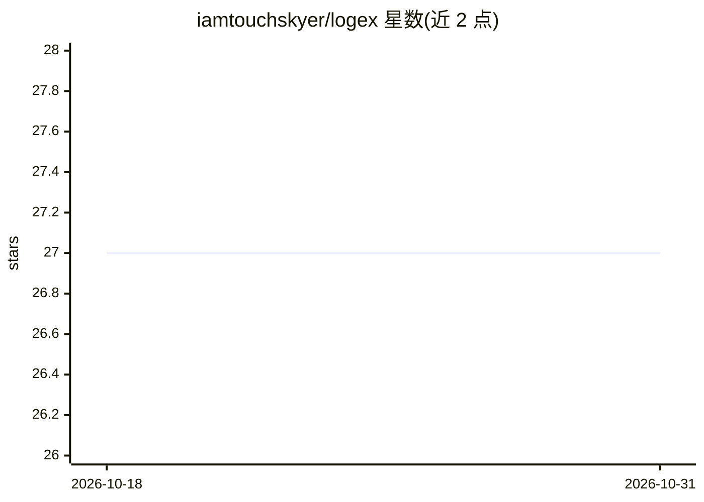

# iamtouchskyer/logex

⭐ 27 · TypeScript · MIT · 推送 2026-09-08 · [GitHub](https://github.com/iamtouchskyer/logex) · [官网](https://session-brain.vercel.app) · 个人维护 · 中文 README

**把 coding agent 会话记录转成博客文章的脚手架工具**

读取 Claude Code、Codex、Pi、DSH 四种 coding agent 的会话 JSONL 记录，将解析、分块、打分、按信号分组做成纯 pipeline，话题切分与文章写作交由会话中已有的 LLM 完成，无需额外 API key。一次长会话通常产出 1–3 篇结构化 JSON 文章，通过 GitHub Contents API 发布到独立 data 仓库，React + Vite webapp 渲染为博客。以 Claude Code plugin/skill/hook 形式集成，另提供 MCP server 供 Cursor、Codex、Windsurf 等客户端调用，还有实验性 VS Code 与 Pi 扩展。需要 Node.js 18+。

## 筛选速览

| 维度 | 判定 | 备注 |
|---|---|---|
| AI 角色 | `ai-ecosystem` | LLM/agent 周边工具 |
| 许可风险 | `permissive` | MIT |
| 部署形态 | `library` | 以包/库形式分发 |
| 模型依赖 | locked-api |  |
| 硬件要求 | — | 无带数字的原话,不猜 |
| 安装摩擦 | `low` | 无编译、无系统依赖或容器化 |
| 成熟度 | — | 结构信号不足 |

## 能力要点

- 支持 Claude Code/Codex/Pi/DSH 四种会话 JSONL，自动扫描会话目录
- 话题切分与写作由会话内 LLM 完成，无需额外 API key
- 提供 MCP server 供任意 MCP 客户端调用
- 以 Claude Code plugin + skill + Stop hook 形式一键集成

## 适用场景

- 把 Claude Code 里的工作会话沉淀为技术博客文章
- 在其他 MCP 客户端（Cursor/Windsurf）中驱动会话成文流程
- session 结束时收到写文章提醒并一键生成

## 场景标签

`AI 写作` · 领域:内容生成

## 证据(README 行号)

> L38: logex prepare <jsonl>      # parse → chunk → score → segmentation prompt (no LLM)
> L43: The agent is the one deciding topic boundaries and drafting the prose — `logex` is the scaffolding around it.
> L40: logex mcp                  # start MCP server for other agents

## 星数曲线

2026-10-18 27 → 2026-10-31 27（+0）

---
*卡片 v1 · prompt 1.4 · 生成 2026-10-26 · 置信度 high · 依据 README sha `afab1690cc01` · [字段定义](../../DATASET.md)*
