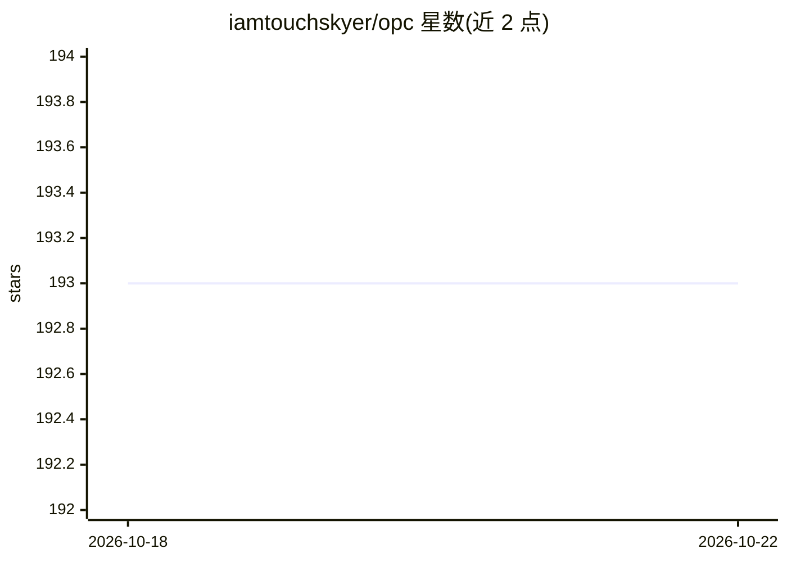

# iamtouchskyer/opc

⭐ 193 · JavaScript · MIT · 推送 2026-09-08 · [GitHub](https://github.com/iamtouchskyer/opc) · 个人维护 · 中文 README

**单人多角色 Claude Code 技能：编排 21 个 agent 角色完成开发与质检**

以 Claude Code skill 形式提供的多 agent 编排器：内置 PM、设计、安全、Devil's Advocate 等 21 个角色，通过有向图流水线与 6 个流程模板（quick/review/build-verify/full-stack/pre-release 等）执行构建、并行评审与测试；质量门由 opc-harness 以代码规则计算判定，不依赖 LLM 裁决。支持自主循环：任务分解、持久 cron 调度、代码级护栏（计划哈希校验、≥2 独立评审、振荡检测），README 称可在无人值守下运行 10+ 小时。提供扩展 hook 机制与自定义角色文件。需 Claude Code 与 Node.js>=18，核心运行时无 npm 依赖。

## 筛选速览

| 维度 | 判定 | 备注 |
|---|---|---|
| AI 角色 | `ai-ecosystem` | LLM/agent 周边工具 |
| 许可风险 | `permissive` | MIT |
| 部署形态 | `library` | 以包/库形式分发 |
| 模型依赖 | locked-api |  |
| 硬件要求 | — | 无带数字的原话,不猜 |
| 安装摩擦 | `low` | 无编译、无系统依赖或容器化 |
| 成熟度 | — | 结构信号不足 |

## 能力要点

- 21 个内置角色 + 6 个流程模板，评审节点并行派发子 agent
- 质量门由代码规则（opc-harness synthesize）机械计算判定
- 自主循环：任务分解 + 持久 cron + 代码级护栏（计划完整性、评审独立性、振荡检测）
- npm 全局安装，skill 文件自动复制到 ~/.claude/skills/opc/

## 适用场景

- 一句话需求生成完整可交付的网站或产品
- 并行派发安全/后端/无障碍等多角色做代码评审
- 发布前自动跑验收、审计与 e2e 质量门
- 无人值守长时任务：按计划单元定时推进并强制提交

## 场景标签

 · 领域:AI 编排/开发工作流

## 证据(README 行号)

> L3: > A full team in a single Claude Code skill. You're the CEO — OPC is everyone else.
> L5: 21 built-in roles (PM, Designer, Security, Devil's Advocate, and more) that build, review, and evaluate your code th

## 星数曲线

2026-10-18 193 → 2026-10-22 193（+0）

---
*卡片 v1 · prompt 1.4 · 生成 2026-10-22 · 置信度 high · 依据 README sha `3800dbc9526c` · [字段定义](../../DATASET.md)*
