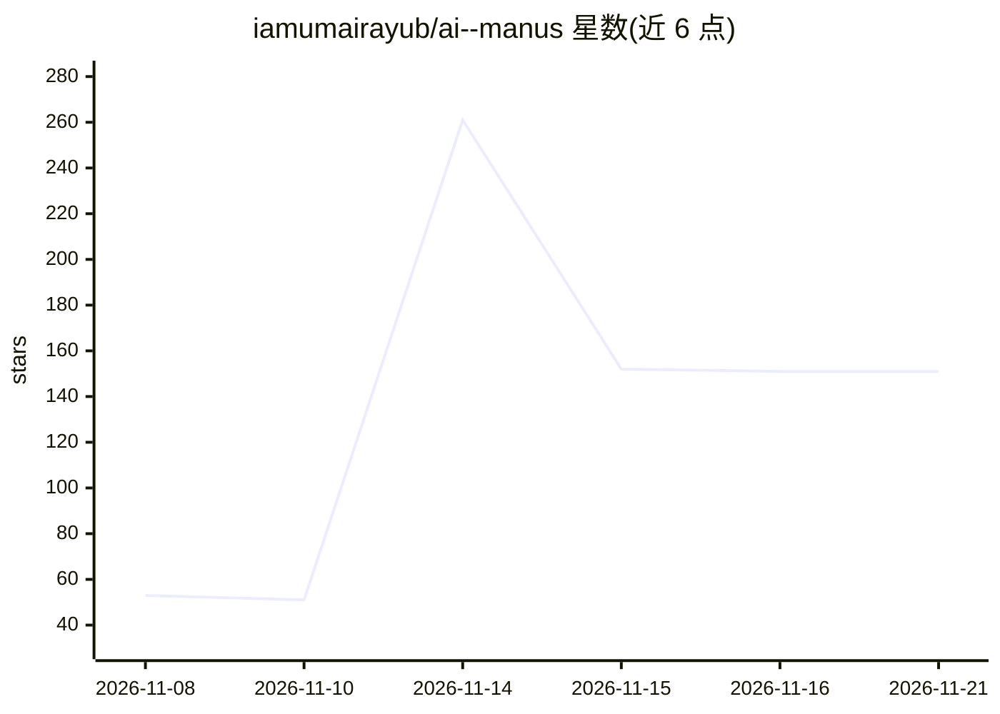

# iamumairayub/ai--manus

⭐ 151 · Apache-2.0 · 推送 2026-11-15 · [GitHub](https://github.com/iamumairayub/ai--manus) · 个人维护

**面向个人用户的自主 AI Agent：代跑代码与操控浏览器**

名为 Manus 的自主 AI Agent 系统，在沙箱环境中运行各类工具与操作：自主编写并执行脚本、控制浏览器（导航网页、填表、采集信息）、执行多步骤日常任务。面向家庭、学习与轻量办公场景的用户，定位为后台个人助手而非企业平台。README 提供硬件兼容表与六步上手流程，但未给出具体安装命令、技术架构或支持的模型接入方式，功能描述均停留在宣传口径。

## 筛选速览

| 维度 | 判定 | 备注 |
|---|---|---|
| AI 角色 | `ai-native` | 本体是模型或模型工具 |
| 许可风险 | `permissive` | Apache-2.0 |
| 部署形态 | `None` |  |
| 模型依赖 | — | README 未给出锁定关系 |
| 硬件要求 | — | 无带数字的原话,不猜 |
| 安装摩擦 | `low` | 无编译、无系统依赖或容器化 |
| 成熟度 | — | 结构信号不足 |

## 能力要点

- 自主编写并执行代码完成任务
- 浏览器控制：导航、填表、跨页采集信息
- 脚本与浏览器操作可在同一任务流中衔接
- 跨会话记忆工作流模式

## 适用场景

- 让学生整理研究笔记、跑快速计算
- 代替人工在多个网页间采集数据做摘要
- 把重复性小任务交给后台代理处理

## 场景标签

`AI 助手` `编码 Agent` `浏览器自动化` · 领域:效率与自动化

## 证据(README 行号)

> L10: - **Autonomous Code Execution:** Manus AI agent runs code on its own to complete tasks, so you can focus on decisio
> L18: Manus is an autonomous AI agent designed to run code and control a browser on your behalf. Instead of acting like a

## 星数曲线

2026-11-08 53 → 2026-11-21 151（+98）

---
*卡片 v1 · prompt 1.4 · 生成 2026-11-17 · 置信度 mid · 依据 README sha `457a5fad1755` · [字段定义](../../DATASET.md)*
