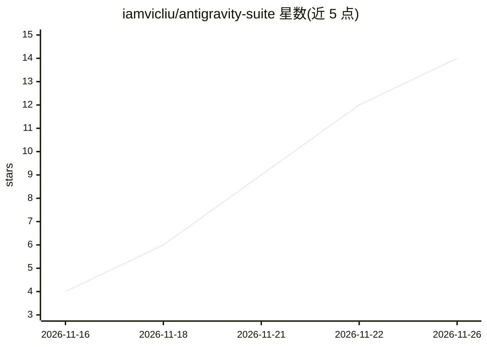

# iamvicliu/antigravity-suite

⭐ 14 · JavaScript · MIT · 推送 2026-11-25 · [GitHub](https://github.com/iamvicliu/antigravity-suite) · 个人维护 · 中文 README

**Google Antigravity macOS 桌面端免改包增强与手机遥控套件**

通过 CDP 纯内存挂载为 Google Antigravity macOS 桌面端附加 6 类功能，不修改官方安装包：手机/电脑远程控制（局域网/Tailscale/Bonjour/Cloudflare 隧道四通道配对）、全中文化与本地思考翻译（不耗额度）、上下文与 5h/每周配额看板、自动检测更新一键升级、快捷键切会话/行内编辑/Tab 补全等小工具、高危命令红框拦截。要求 macOS 与 Node.js 22.4+，git clone 后运行脚本安装，提供 CLI 管理与卸载流程。

## 筛选速览

| 维度 | 判定 | 备注 |
|---|---|---|
| AI 角色 | `ai-ecosystem` | LLM/agent 周边工具 |
| 许可风险 | `permissive` | MIT |
| 部署形态 | `None` |  |
| 模型依赖 | — | README 未给出锁定关系 |
| 硬件要求 | — | 无带数字的原话,不猜 |
| 安装摩擦 | `low` | 无编译、无系统依赖或容器化 |
| 成熟度 | — | 结构信号不足 |

## 能力要点

- 四通道远程控制：扫码 PWA 遥控，支持自动测速切最快路线与设备管理
- 上下文与 Gemini/Claude 5 小时+每周配额双窗口监控看板
- 英文思考与标题本地中译，零 Token 消耗，中英秒切
- 高危命令（rm -rf/sudo 等）红框强制拦截确认

## 适用场景

- 手机扫码遥控家里 Mac 上的 Antigravity 会话
- 监控账号的上下文占用与订阅配额余量
- 读英文思考过程时自动中译
- AI 执行危险命令前强制人工确认

## 场景标签

 · 领域:开发工具/AI 客户端增强

## 证据(README 行号)

> L3: > **给 Google Antigravity 桌面端（macOS）加实用功能的小工具——不修改官方安装包，不影响官方升级，随时可关。**
> L9: 3. **📊 上下文与额度看板**：右上角直接看这次对话用了多少上下文，以及 Gemini / Claude 5 小时与每周额度还剩多少。

## 星数曲线

2026-11-16 4 → 2026-11-26 14（+10）

---
*卡片 v1 · prompt 1.4 · 生成 2026-11-20 · 置信度 high · 依据 README sha `2925e295993f` · [字段定义](../../DATASET.md)*
