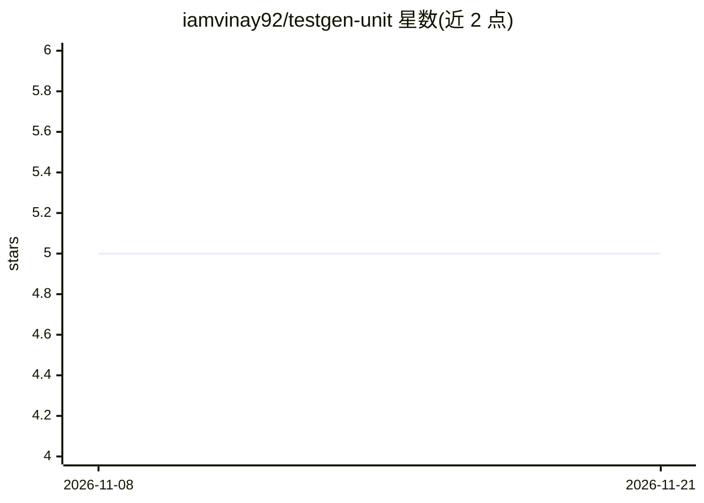

# iamvinay92/testgen-unit

⭐ 5 · JavaScript · MIT · 推送 2026-11-02 · [GitHub](https://github.com/iamvinay92/testgen-unit) · 个人维护

**为 Go/Java/Python 项目生成单元测试的 CLI 与编码代理技能**

围绕测试覆盖率改进提供可复用工作流：测量→生成→验证→再测量→审查。CLI 本身执行项目工具链（gofmt/JaCoCo/coverage.py 等）并报告结果，测试生成由用户的编码代理、本地 Ollama 模型或兼容 API 完成；`install-skill` 可将技能装入 .agents/.claude/.opencode 目录。v0.1 限定 Linux/macOS CI 平台，Windows 构建包装与自定义 Python runner 不支持。

## 筛选速览

| 维度 | 判定 | 备注 |
|---|---|---|
| AI 角色 | `ai-ecosystem` | LLM/agent 周边工具 |
| 许可风险 | `permissive` | MIT |
| 部署形态 | `library` | 以包/库形式分发 |
| 模型依赖 | local-ok | 支持本地模型 |
| 硬件要求 | — | 无带数字的原话,不猜 |
| 安装摩擦 | `low` | 无编译、无系统依赖或容器化 |
| 成熟度 | — | 结构信号不足 |

## 能力要点

- 提供 measure/generate/validate/review 全流程 CLI 命令与编码代理技能
- 支持本地 Ollama 模型与兼容 API 端点，明确 --provider 才发送源码上下文
- install-skill 一次写入三个代理技能目录并保留已有文件
- 内置 Git 范围守卫与启发式审查（重复测试、sleep、断言检查）

## 适用场景

- 让编码代理把仓库单元测试覆盖率提升到指定目标
- 无付费模型 API 时用本地模型生成测试建议
- 在 CI 中用 --fail-under 阈值门禁覆盖率与审查结果

## 场景标签

`代码生成` · 领域:编码与开发

## 证据(README 行号)

> L9: The agent writes tests. The CLI runs your project's tools and reports what actually happened. Use your existing AI a
> L71: testgen-unit install-skill

## 星数曲线

2026-11-08 5 → 2026-11-21 5（+0）

---
*卡片 v1 · prompt 1.4 · 生成 2026-11-21 · 置信度 mid · 依据 README sha `8507d7c01d4e` · [字段定义](../../DATASET.md)*
