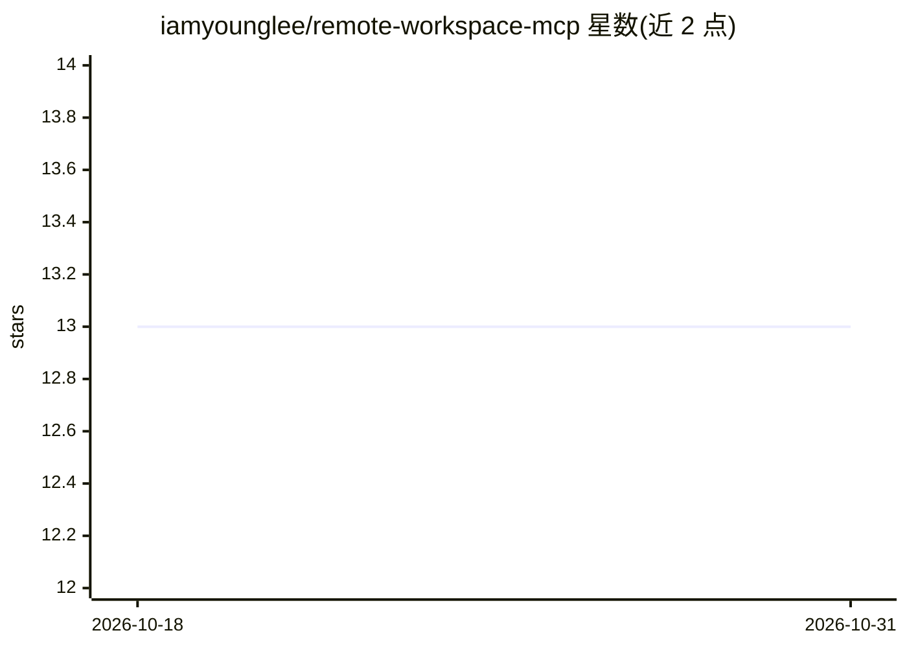

# iamyounglee/remote-workspace-mcp

⭐ 13 · Go · MIT · 推送 2026-09-05 · [GitHub](https://github.com/iamyounglee/remote-workspace-mcp) · 个人维护 · 中文 README

**部署在远端机器的 MCP 服务，让编码 Agent 远程操作工作区**

Go 编写的 MCP 服务（remote-workspace-mcpd），通过 Streamable HTTP 向编码 Agent 提供远程文件读写（read/write/edit/apply_patch）、搜索（grep/glob）、受控 bash 命令执行、文件/目录传输与基于 SHA-256 manifest 的增量同步。访问范围由静态 Bearer Token 鉴权、Workspace/路径白名单与可选 Bubblewrap 沙箱（仅 Linux）约束，提供审计日志与 TLS。面向需要让编码 Agent 安全操作远端机器（内网机、CI 节点、临时云开发机）的开发者。

## 筛选速览

| 维度 | 判定 | 备注 |
|---|---|---|
| AI 角色 | `ai-ecosystem` | LLM/agent 周边工具 |
| 许可风险 | `permissive` | MIT |
| 部署形态 | `desktop` | 安装包/桌面程序 |
| 模型依赖 | — | README 未给出锁定关系 |
| 硬件要求 | — | 无带数字的原话,不猜 |
| 安装摩擦 | `low` | 无编译、无系统依赖或容器化 |
| 成熟度 | — | 结构信号不足 |

## 能力要点

- read/write/edit/apply_patch/grep/glob/bash 等 MCP 工具集
- 基于 manifest 与 SHA-256 的目录增量同步
- 路径白名单、静态 Bearer Token 与 Linux Bubblewrap 沙箱隔离
- 工具调用审计（记录操作、耗时、客户端 IP）

## 适用场景

- 让网页版编码 Agent 通过 MCP 读写远端仓库、运行构建与测试
- 在内网受限机器上部署，供 Agent 通过 HTTP 操作内网代码
- 在 CI 构建节点临时部署，让 Agent 现场查日志、复现并打补丁
- 多个编码 Agent 共享同一远端工作区并保持增量同步

## 场景标签

`编码 Agent` · 领域:编码与开发

## 证据(README 行号)

> L8: `remote-workspace-mcpd` 是部署在远端机器上的 MCP 服务。它通过 Streamable HTTP 向编码 Agent 提供「像操作本地工作区一样」的远程文件读写、代码搜索、受控命令执行、文件传输与目录增量同
> L24: - **MCP 工具**：`read`、`write`、`edit`、`apply_patch`、`grep`、`glob`、`list`、`bash`。
> L37: 1. **接入 DeepSeek++ 浏览器插件做远端开发**：把服务部署在开发机或云主机上，在浏览器里的 DeepSeek++ 插件中配置 `streamableHttp` 类型的 MCP 指向该服务，即可让网页版对话模型直接读

## 星数曲线

2026-10-18 13 → 2026-10-31 13（+0）

---
*卡片 v1 · prompt 1.4 · 生成 2026-10-31 · 置信度 high · 依据 README sha `3ead9809fa7e` · [字段定义](../../DATASET.md)*
