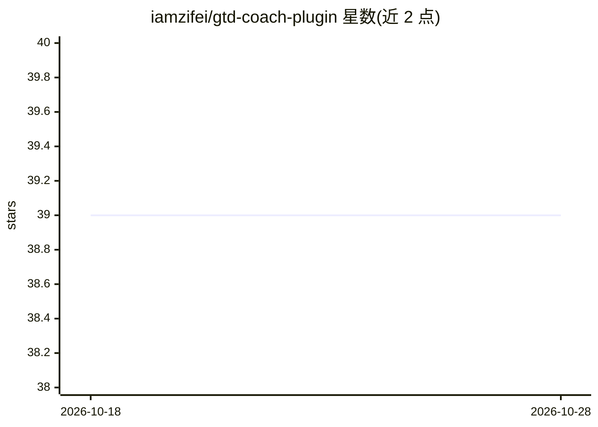

# iamzifei/gtd-coach-plugin

⭐ 39 · MIT · 推送 2026-09-01 · [GitHub](https://github.com/iamzifei/gtd-coach-plugin) · 个人维护 · 中文 README

**Claude Code 插件：把年度目标拆解为每日任务并跟踪进度**

面向个人用户的 GTD 教练插件，运行于 Claude Code：将高层目标转换为带季度里程碑的 SOP 框架，按时间位置生成优先级日任务列表，并可将任务逐步拆解为行动步骤。利用 Claude 的 memory 系统跨会话持久化目标、阶段与进度，提供日/周/月/季度复盘模板与 8 条对话命令，支持英文、中文、日文。限制：记忆在同一 Claude 账户内持久，清除记忆或无痕模式会重置。

## 筛选速览

| 维度 | 判定 | 备注 |
|---|---|---|
| AI 角色 | `ai-native` | 本体是模型或模型工具 |
| 许可风险 | `permissive` | MIT |
| 部署形态 | `None` |  |
| 模型依赖 | locked-api |  |
| 硬件要求 | — | 无带数字的原话,不猜 |
| 安装摩擦 | `low` | 无编译、无系统依赖或容器化 |
| 成熟度 | — | 结构信号不足 |

## 能力要点

- 目标→SOP 框架与季度里程碑转换
- 基于时间位置的每日优先任务生成
- 跨会话记忆持久化进度，无需重复上下文
- 日/周/月/季度复盘模板与多语言（英/中/日）

## 适用场景

- 把年度目标持续拆解为今天该做的具体任务
- 通过对话更新任务完成情况并查看进度
- 按周期做复盘并根据实际进展调整计划

## 场景标签

`AI 助手` · 领域:对话与助手

## 证据(README 行号)

> L7: Personal GTD (Getting Things Done) coach that transforms annual goals into actionable daily tasks with automatic pro
> L14: - **Automatic Memory**: Progress persists across conversations - no need to repeat context

## 星数曲线

2026-10-18 39 → 2026-10-28 39（+0）

---
*卡片 v1 · prompt 1.4 · 生成 2026-10-25 · 置信度 high · 依据 README sha `821e5631ec38` · [字段定义](../../DATASET.md)*
