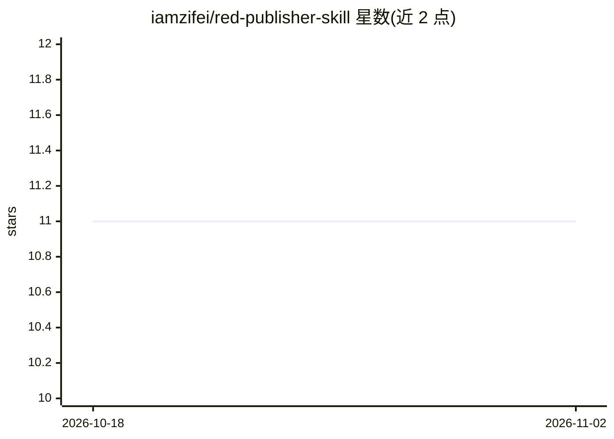

# iamzifei/red-publisher-skill

⭐ 11 · Python · MIT · 推送 2026-08-12 · [GitHub](https://github.com/iamzifei/red-publisher-skill) · 个人维护 · 中文 README

**让 Claude Code 一键发布图片笔记到小红书的技能（CDP 连接浏览器）**

面向 Claude Code 用户的技能（Skill/插件）：通过 CDP 模式连接用户已登录的 Chrome（调试端口 9222），用 agent-browser CLI 自动化发布图片笔记到小红书。从图片+文字或 Markdown 文件解析标题、内容与标签，单篇支持 1-18 张图片（JPG/PNG/GIF/WebP），默认保存草稿，可指定直接发布；支持通过 Chrome 配置文件切换多账号。运行要求：Claude Code、带调试端口的 Chrome、Python 3.9+（Pillow、pyobjc），目前仅支持 macOS。安装提供 git clone 到 ~/.claude/skills/ 或插件市场两种方式。

## 筛选速览

| 维度 | 判定 | 备注 |
|---|---|---|
| AI 角色 | `ai-ecosystem` | LLM/agent 周边工具 |
| 许可风险 | `permissive` | MIT |
| 部署形态 | `library` | 以包/库形式分发 |
| 模型依赖 | locked-api |  |
| 硬件要求 | — | 无带数字的原话,不猜 |
| 安装摩擦 | `low` | 无编译、无系统依赖或容器化 |
| 成熟度 | — | 结构信号不足 |

## 能力要点

- CDP 模式连接已有 Chrome 会话，登录一次即可复用
- 单篇最多上传 18 张图片，支持 Markdown 解析标题/内容/标签
- 默认存草稿，可指定直接发布；多账号经 Chrome 配置文件切换
- 提供 git clone 与插件市场两种安装方式

## 适用场景

- 在 Claude Code 中用自然语言一键把图片笔记发到小红书
- 把写好的 Markdown 笔记自动解析并发布为小红书草稿
- 多个小红书账号之间切换发布

## 场景标签

`浏览器自动化` · 领域:效率与自动化

## 证据(README 行号)

> L9: > Publish images and notes to Xiaohongshu (小红书) with one command. Uses CDP mode to connect to your existing browser 
> L75: |Claude Code|claude.ai/code|
> L312: |macOS|目前仅支持 macOS|

## 星数曲线

2026-10-18 11 → 2026-11-02 11（+0）

---
*卡片 v1 · prompt 1.4 · 生成 2026-11-02 · 置信度 mid · 依据 README sha `8ccda521a518` · [字段定义](../../DATASET.md)*
