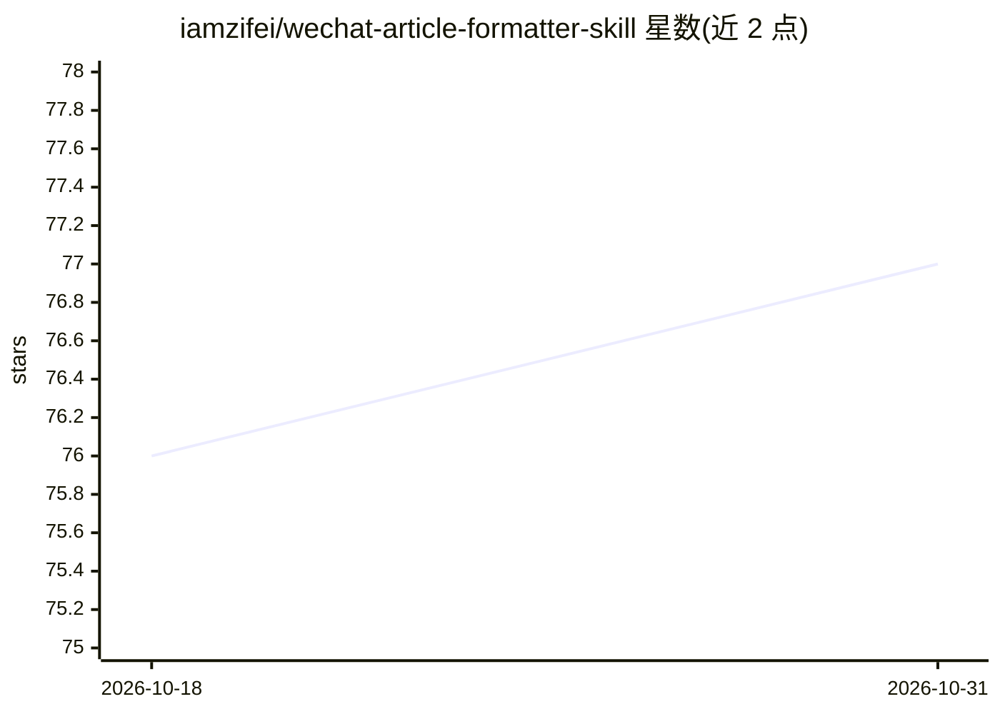

# iamzifei/wechat-article-formatter-skill

⭐ 77 · CSS · 推送 2026-08-12 · [GitHub](https://github.com/iamzifei/wechat-article-formatter-skill) · 个人维护 · 中文 README

**将 Markdown 排版为微信公众号 HTML 的 Claude Code 技能**

面向 Claude Code 的技能（skill）：读取 Markdown 文件，检测本地图片并调用 /image-upload 技能上传替换为在线 URL，再调用 bm.md 渲染服务生成内联 CSS、适配公众号阅读的 HTML，可选通过 wechat-article-publisher-skill 发布为公众号草稿。样式可通过 styles/custom.css 修改。运行需要 Claude Code CLI、网络访问 bm.md API，本地图片支持需另装 /image-upload 技能。

## 筛选速览

| 维度 | 判定 | 备注 |
|---|---|---|
| AI 角色 | `ai-ecosystem` | LLM/agent 周边工具 |
| 许可风险 | `none` | — |
| 部署形态 | `None` |  |
| 模型依赖 | — | README 未给出锁定关系 |
| 硬件要求 | — | 无带数字的原话,不猜 |
| 安装摩擦 | `low` | 无编译、无系统依赖或容器化 |
| 成熟度 | — | 结构信号不足 |

## 能力要点

- Markdown 转微信公众号优化 HTML（bm.md 渲染，green-simple 主题）
- 本地图片自动上传并替换为在线 URL（PNG/JPG/GIF/WebP/SVG）
- 脚注链接转换、GFM 语法、移动端阅读适配
- 通过 claude skill add 命令安装

## 适用场景

- 我把技术文章排版成可直接粘贴到公众号的 HTML
- 文章里有本地截图时自动上传图床替换路径
- 自定义 CSS 调整公众号文章配色与字体

## 场景标签

 · 领域:内容创作/排版工具

## 证据(README 行号)

> L5: A Claude Code skill that formats markdown files into beautifully styled HTML optimized for WeChat public account art
> L123: - Claude Code CLI

## 星数曲线

2026-10-18 76 → 2026-10-31 77（+1）

---
*卡片 v1 · prompt 1.4 · 生成 2026-10-24 · 置信度 high · 依据 README sha `276a651be5a5` · [字段定义](../../DATASET.md)*
