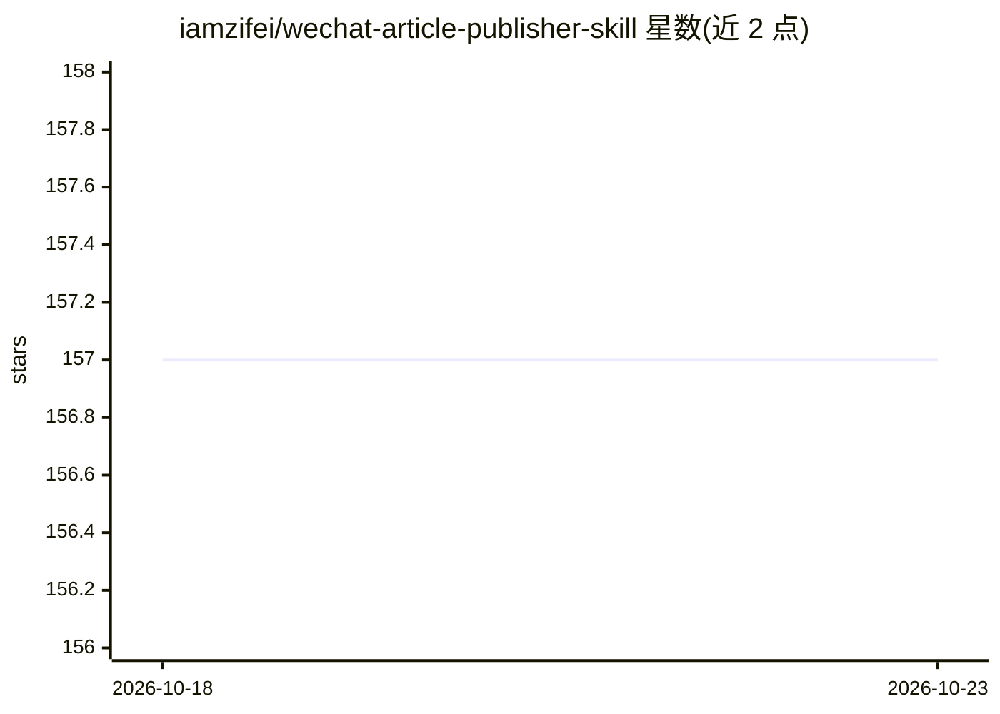

# iamzifei/wechat-article-publisher-skill

⭐ 157 · Python · MIT · 推送 2026-08-12 · [GitHub](https://github.com/iamzifei/wechat-article-publisher-skill) · 个人维护 · 中文 README

**把 Markdown/HTML 文章一键发布到微信公众号草稿箱的 Claude Skill**

面向微信公众号作者的 Claude Code 技能：读取本地 Markdown 或 HTML 文件，经 Python 解析转换为公众号格式，通过微信 API 生成草稿，仅保存草稿不自动发布。支持图片自动上传（本地路径与 URL）、HTML 格式保留、小绿书（newspic）图文模式（最多 20 图、文字限 1000 字）。依赖 Claude Code、Python 3.9+（仅标准库）及从 wx.limyai.com 获取的 WECHAT_API_KEY，跨 macOS/Linux/Windows，也提供 WorkBuddy、Codex、豆包、Trae 等技能目录安装方式。

## 筛选速览

| 维度 | 判定 | 备注 |
|---|---|---|
| AI 角色 | `ai-ecosystem` | LLM/agent 周边工具 |
| 许可风险 | `permissive` | MIT |
| 部署形态 | `None` |  |
| 模型依赖 | — | README 未给出锁定关系 |
| 硬件要求 | — | 无带数字的原话,不猜 |
| 安装摩擦 | `low` | 无编译、无系统依赖或容器化 |
| 成熟度 | — | 结构信号不足 |

## 能力要点

- Markdown/HTML 双格式解析与自动格式检测
- 图片自动上传到微信服务器（本地路径与 URL）
- 小绿书（newspic）图文模式：最多 20 图、文字限 1000 字
- 仅保存草稿不自动发布，支持多公众号选择

## 适用场景

- 把 Markdown 写作的文章直接发到公众号草稿箱，省去手动排版
- 把带内联样式的 HTML 文章保留格式发布到公众号
- 以小绿书图文格式发布图片为主的内容

## 场景标签

 · 领域:内容发布/自媒体工具

## 证据(README 行号)

> L58: |Claude Code|claude.ai/code|
> L87: git clone https://github.com/iamzifei/wechat-article-publisher-skill.git

## 星数曲线

2026-10-18 157 → 2026-10-23 157（+0）

---
*卡片 v1 · prompt 1.4 · 生成 2026-10-22 · 置信度 high · 依据 README sha `fff88e92d249` · [字段定义](../../DATASET.md)*
