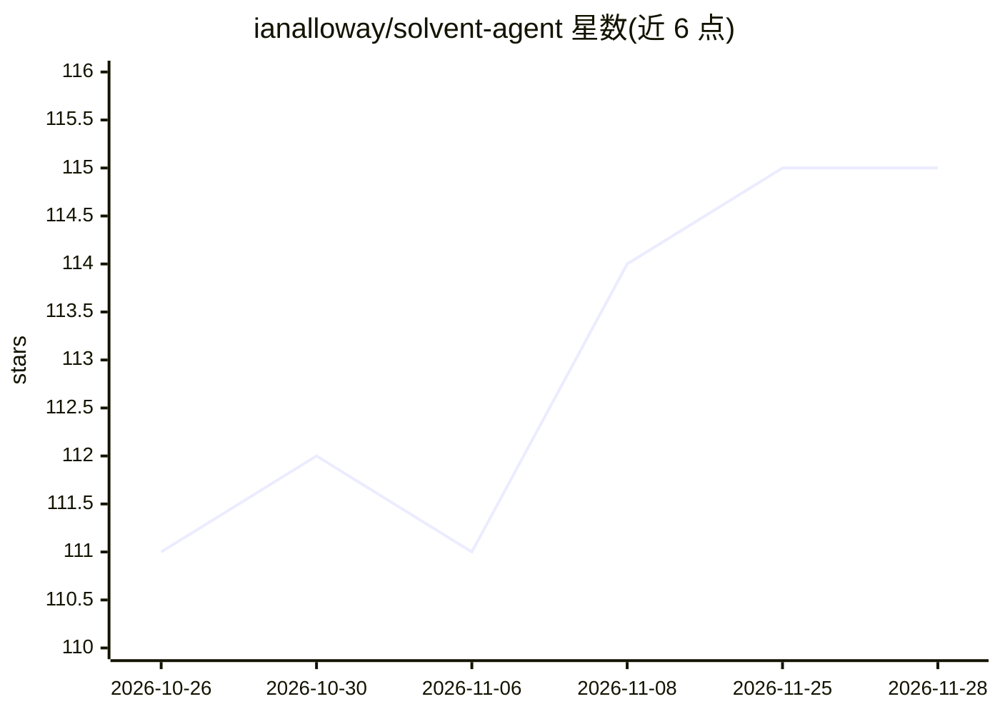

# ianalloway/solvent-agent

⭐ 115 · Python · MIT · 推送 2026-11-27 · [GitHub](https://github.com/ianalloway/solvent-agent) · [官网](https://pypi.org/project/solvent-agent/) · 个人维护

**离线优先的 Python AI agent：模拟经营一个自带利润门控的小型研究业务**

SOLVENT 是一个 CLI 形式的 AI agent，模拟研究业务的完整商业闭环：对每个任务先按自身成本报价，低于利润下限即拒单并给出反向报价，通过 Stripe（测试模式/模拟）收款、在支出策略内支付供应商账单，并记录损益。默认无 API key 时以确定性 stub 离线运行；可选启用 NVIDIA Nemotron 真实推理、Stripe test-mode Payment Links、FastAPI webhook 与 Telegram 通道。内置 SQLite 账本、支出策略沙箱（供应商白名单、单笔上限、24h 滚动预算）与 HTML 仪表盘。所有金额为模拟数据，非真实收入。

## 筛选速览

| 维度 | 判定 | 备注 |
|---|---|---|
| AI 角色 | `ai-native` | 本体是模型或模型工具 |
| 许可风险 | `permissive` | MIT |
| 部署形态 | `library` | 以包/库形式分发 |
| 模型依赖 | — | README 未给出锁定关系 |
| 硬件要求 | — | 无带数字的原话,不猜 |
| 安装摩擦 | `low` | 无编译、无系统依赖或容器化 |
| 成熟度 | — | 结构信号不足 |

## 能力要点

- 利润门控：margin 低于下限的任务在触碰 Stripe 前即拒单并给出反向报价
- NemoClaw 风格支出策略沙箱：供应商白名单、单笔上限、滚动 24h 预算、最低现金储备
- 离线优先：无 key 时以确定性 stub 跑通完整演示，30 秒完成 5 个任务
- SQLite 账本与审计追踪：checkout session 与 PaymentIntent ID 全量记录

## 适用场景

- 演示一个带支出约束与利润门控的自主 agent 闭环
- 作为 SpendAudit 基准的标签来源研究 LLM 审计行为
- 本地复现 agent 收支流程并查看损益仪表盘

## 场景标签

`AI 助手` · 领域:对话与助手

## 证据(README 行号)

> L3: **A Python agent that runs a tiny research business: it quotes each job against its own costs, gets paid through Str
> L147: |**Analyst / reasoning**|NVIDIA Nemotron (Llama-3.1-Nemotron-Ultra)|`solvent/nemotron.py`|
> L159: - **Offline-first** — without API keys the demo runs on deterministic stubs. Add `NVIDIA_API_KEY` + `STRIPE_API_KE

## 星数曲线

2026-10-26 111 → 2026-11-28 115（+4）

---
*卡片 v1 · prompt 1.4 · 生成 2026-11-28 · 置信度 high · 依据 README sha `e405232ca91e` · [字段定义](../../DATASET.md)*
