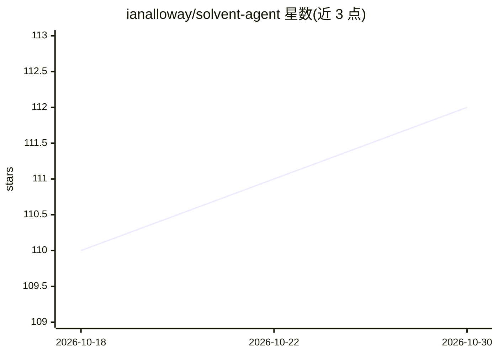

# ianalloway/solvent-agent

⭐ 112 · Python · MIT · 推送 2026-10-28 · [GitHub](https://github.com/ianalloway/solvent-agent) · [官网](https://pypi.org/project/solvent-agent/) · 个人维护

**离线优先的 Python AI 代理：自主运营研究接单业务并自负盈亏**

CLI/FastAPI 形式的 Python 代理，模拟一个微型研究生意闭环：报价前先核算成本并执行利润门槛（不达标则拒单或发出反报价）、经 Stripe 收款、由 NVIDIA Nemotron 完成研究交付、在支出策略沙箱（供应商白名单、单笔上限、24h 滚动预算）内向供应商付款并记账。无 API key 时全流程用确定性离线 stub 运行，设置 NVIDIA/Stripe key 后接入真实推理与测试模式支付。提供 pip/pipx 安装、批处理/交互/生产（webhooks+worker）三种模式与 HTML 财务仪表盘。

## 筛选速览

| 维度 | 判定 | 备注 |
|---|---|---|
| AI 角色 | `ai-native` | 本体是模型或模型工具 |
| 许可风险 | `permissive` | MIT |
| 部署形态 | `library` | 以包/库形式分发 |
| 模型依赖 | — | README 未给出锁定关系 |
| 硬件要求 | — | 无带数字的原话,不猜 |
| 安装摩擦 | `low` | 无编译、无系统依赖或容器化 |
| 成熟度 | — | 结构信号不足 |

## 能力要点

- 利润门槛报价：先核算单位成本，低于下限的订单不进入 Stripe
- 支出策略沙箱：供应商白名单、单笔与单供应商 24h 上限、最低现金储备
- 零依赖离线演示：无 key 无网络即可跑通 5 个样本任务
- 拒单自动生成反报价（缩范围或最低可行价）

## 适用场景

- 探索能自主收款、履约、付款并记账的 agent 业务闭环
- 研究带支出护栏的 agent 财务安全机制
- 在浏览器/本地离线体验无 key 的完整业务模拟

## 场景标签

`科研工具` · 领域:学习与行业

## 证据(README 行号)

> L3: **A Python agent that runs a tiny research business: it quotes each job against its own costs, gets paid through Str
> L142: |**Analyst / reasoning**|NVIDIA Nemotron (Llama-3.1-Nemotron-Ultra)|`solvent/nemotron.py`|
> L153: - **Offline-first** — without API keys the demo runs on deterministic stubs. Add `NVIDIA_API_KEY` + `STRIPE_API_KE

## 星数曲线

2026-10-18 110 → 2026-10-30 112（+2）

---
*卡片 v1 · prompt 1.4 · 生成 2026-10-23 · 置信度 high · 依据 README sha `8df4e9a02c6a` · [字段定义](../../DATASET.md)*
