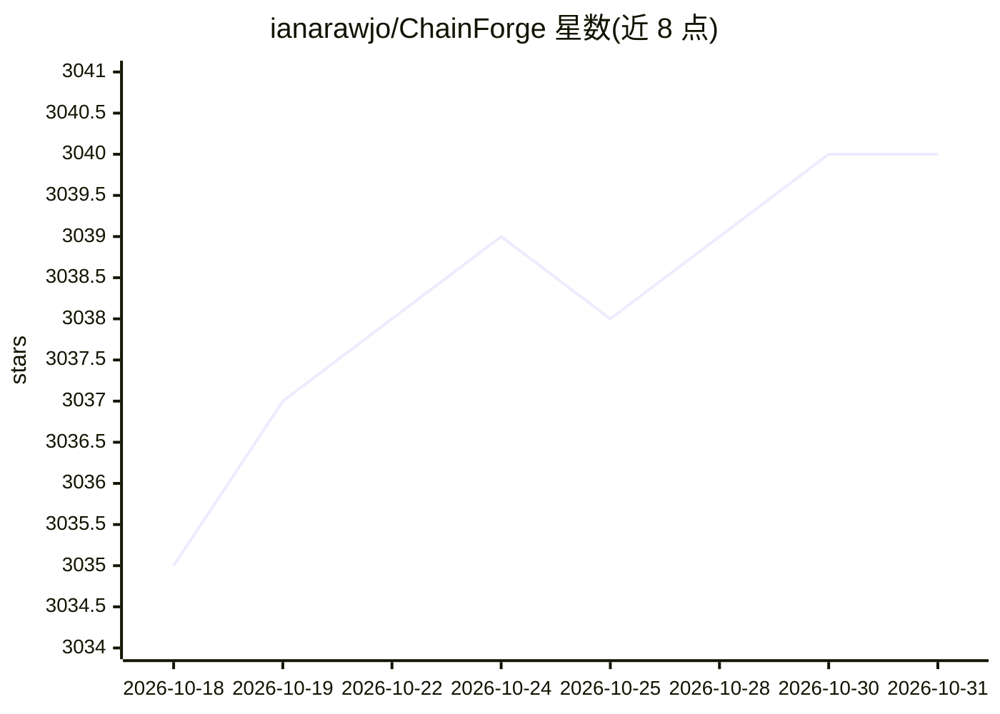

# ianarawjo/ChainForge

⭐ 3,040 · TypeScript · MIT · 推送 2026-10-29 · [GitHub](https://github.com/ianarawjo/ChainForge) · [官网](https://chainforge.ai/docs) · 组织维护

**可视化提示词测试环境：跨模型对比与评估 LLM 响应**

基于 ReactFlow 与 Flask 构建的可视化数据流提示工程环境，面向需要对提示词、模型与模型设置做批量对比评估的开发者与研究者。核心机制：将提示模板输入做笛卡尔积组合，一次向多个 LLM 发起查询；支持 Python 脚本评估节点、可视化图表节点、对话轮测试、ground truth 评估与表格数据导入；内置合成数据生成等 genAI 辅助功能。提供浏览器端 RAG 节点（上传/分块/检索/重排）与服务端 RAG 扩展安装。支持 OpenAI、Anthropic、Google Gemini、Ollama 等十余个提供方，可通过 OPENAI_BASE_URL 接入 OpenAI 兼容网关。经 pip 安装本地运行，另有功能受限的网页版，支持 Docker 部署。

## 筛选速览

| 维度 | 判定 | 备注 |
|---|---|---|
| AI 角色 | `ai-ecosystem` | LLM/agent 周边工具 |
| 许可风险 | `permissive` | MIT |
| 部署形态 | `self-host` | docker 或自建部署 |
| 模型依赖 | local-ok | 支持本地模型 |
| 硬件要求 | — | 无带数字的原话,不猜 |
| 安装摩擦 | `low` | 无编译、无系统依赖或容器化 |
| 成熟度 | — | 结构信号不足 |

## 能力要点

- 提示模板输入取笛卡尔积，一次向多个 LLM 发起批量查询
- Python 脚本评估节点与箱线图/直方图可视化（数值与布尔指标）
- 浏览器端 RAG 节点无需额外安装，另有服务端 RAG 扩展（LanceDB/TF-IDF/重排器）
- 支持十余个提供方及自定义提供方脚本，可经 OPENAI_BASE_URL 接入兼容网关

## 适用场景

- 对比多个提示词变体在多个模型上的回答质量以选型
- 用 Python 评分函数对 LLM 回答做 ground truth 评估并可视化
- 批量发起参数化查询并将结果导出为 Excel 表格

## 场景标签

`提示工程` `模型评测` · 领域:Agent 开发

## 证据(README 行号)

> L8: ChainForge is a data flow prompt engineering environment for analyzing and evaluating LLM responses. It enables rapi
> L91: - OpenRouter (models from many providers, including image models, with one API key)
> L98: - Ollama API (locally-hosted models)

## 星数曲线

2026-10-18 3,035 → 2026-10-31 3,040（+5）

---
*卡片 v1 · prompt 1.4 · 生成 2026-10-20 · 置信度 mid · 依据 README sha `859b95053165` · [字段定义](../../DATASET.md)*
