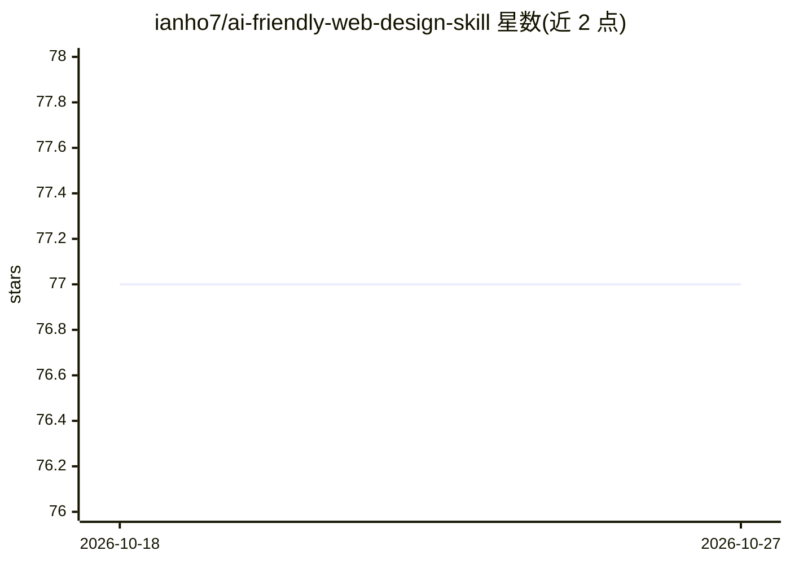

# ianho7/ai-friendly-web-design-skill

⭐ 77 · JavaScript · 推送 2026-06-21 · [GitHub](https://github.com/ianho7/ai-friendly-web-design-skill) · 个人维护 · 中文 README

**面向编码 agent 的 Web UI 设计/审查技能包（SKILL.md）**

以 SKILL.md 为入口、references/ 目录为按需阅读参考的编码 agent 技能包，指导 agent 在前端 UI 的构建、审查与重构中选用语义化 HTML、更清晰的状态、更稳定的定位器与可复现的 URL 模式，使界面更易被人类、屏幕阅读器、浏览器自动化、Playwright 测试与 AI agent 理解操作。审查输出带 🔴/🟡/🟢 三级严重度。安装器面向 Claude Code 风格技能目录（.claude/skills/），其他 agent 可复用相同内容。不含脚本与资源文件，保持轻量。

## 筛选速览

| 维度 | 判定 | 备注 |
|---|---|---|
| AI 角色 | `ai-knowledge` | 知识聚合/清单类 |
| 许可风险 | `none` | — |
| 部署形态 | `library` | 以包/库形式分发 |
| 模型依赖 | — | README 未给出锁定关系 |
| 硬件要求 | — | 无带数字的原话,不猜 |
| 安装摩擦 | `low` | 无编译、无系统依赖或容器化 |
| 成熟度 | — | 结构信号不足 |

## 能力要点

- SKILL.md 入口 + references/ 按需阅读的参考文件结构
- 审查输出按 High/Medium/Low 三级严重度报告
- 覆盖语义 HTML、ARIA、定位器、URL 状态模式与 Playwright 测试生成指导
- 附高频组件配方（component-recipes.md）

## 适用场景

- 让编码 agent 在实现或重构前端 UI 时遵循语义化与可操作性原则
- 审查现有组件的无障碍、可操作性与自动化测试问题
- 生成使用 getByRole/getByLabel 等稳定定位器的 Playwright 测试
- 设计新 UI 流程时先产出 AI 可操作的 UI 方案

## 场景标签

`提示工程` · 领域:Agent 开发

## 证据(README 行号)

> L5: A skill for coding agents that build, review, and refactor Web UI that should be easier for humans, screen readers, 
> L13: `SKILL.md` is the entry file. The files under `references/` are supporting material that should be read on demand, 
> L15: The guidance is written for coding agents in general. The installer in this repo currently targets Claude Code styl

## 星数曲线

2026-10-18 77 → 2026-10-27 77（+0）

---
*卡片 v1 · prompt 1.4 · 生成 2026-10-24 · 置信度 high · 依据 README sha `5ecbccb654a2` · [字段定义](../../DATASET.md)*
