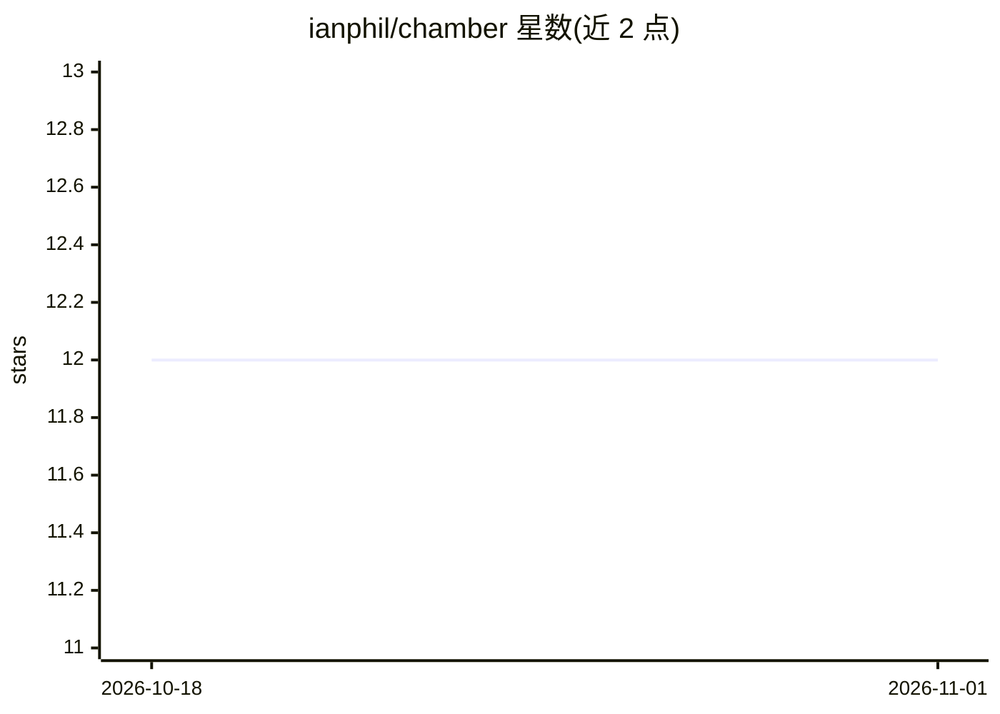

# ianphil/chamber

⭐ 12 · TypeScript · MIT · 推送 2026-09-02 · [GitHub](https://github.com/ianphil/chamber) · [官网](https://chmbr.dev/) · 个人维护

**A2A 多 agent 协作桌面工作台（Electron，Copilot 驱动）**

Electron 桌面应用：创建、运行与协调由 GitHub Copilot 驱动的 AI agent（称为 mind），每个 mind 具备身份、记忆、Agent Card 式技能与工具访问。核心机制是 Agent-to-Agent 协作：agent 发现、点对点消息、带状态的任务委派与取消、共享上下文 ID、产物交接；另提供 Lens 视图、Canvas 页面、cron 定时脚本与 Genesis 市场注册安装。面向希望在桌面端运行多 agent 协作的个人用户；Windows x64 为主要打包目标，macOS/Linux 走发布管道或预览版。凭据存于 OS keychain，mind 目录为用户本地目录。

## 筛选速览

| 维度 | 判定 | 备注 |
|---|---|---|
| AI 角色 | `ai-native` | 本体是模型或模型工具 |
| 许可风险 | `permissive` | MIT |
| 部署形态 | `library` | 以包/库形式分发 |
| 模型依赖 | — | README 未给出锁定关系 |
| 硬件要求 | — | 无带数字的原话,不猜 |
| 安装摩擦 | `low` | 无编译、无系统依赖或容器化 |
| 成熟度 | `idea` | |

## 能力要点

- A2A 协作：agent 发现、直发消息、带状态的任务委派与取消
- Chatroom 支持 concurrent/round-robin/moderated/handoff/manager-led 编排模式
- Lens 视图：view.json 渲染表单、表格、状态板、时间线等界面
- cron 调度由 mind 编写的 TypeScript 自动化脚本（bundled ttasks 运行时）

## 适用场景

- 在桌面端创建并运行多个 Copilot 驱动的 agent
- 让多个 agent 互相委派任务并跟踪进度与产物
- 通过 Lens/Canvas 为 agent 任务定制可视化界面

## 场景标签

`多智能体` · 领域:Agent 开发

## 证据(README 行号)

> L7:  Chamber is an A2A-first desktop workspace for creating, running, and coordinating AI agents powered by GitHub Copil
> L21: Chamber is an Electron desktop app for A2A-style agent collaboration. A Chamber agent, called a **mind**, has ident
> L55: - **Chat** — Stream Copilot-powered turns with markdown, reasoning blocks, tool-call display, attachments, stop con

## 星数曲线

2026-10-18 12 → 2026-11-01 12（+0）

---
*卡片 v1 · prompt 1.4 · 生成 2026-11-01 · 置信度 mid · 依据 README sha `c2d89f8115d0` · [字段定义](../../DATASET.md)*
