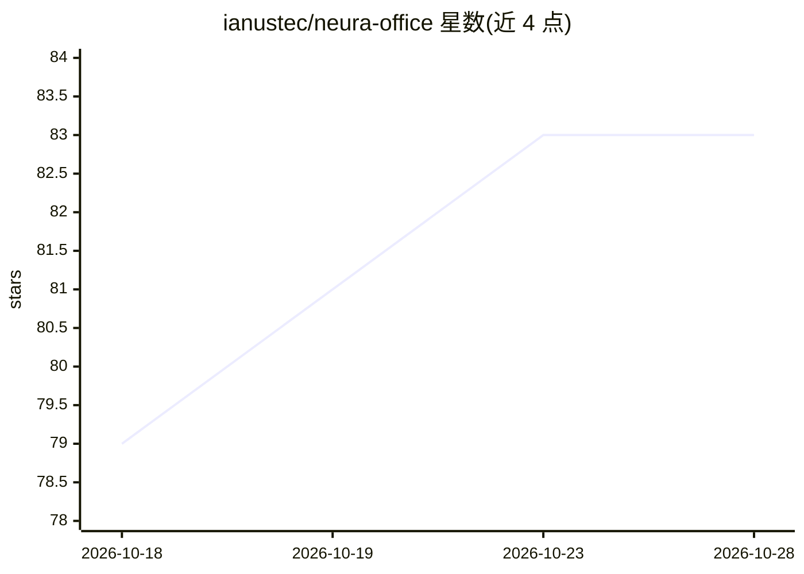

# ianustec/neura-office

⭐ 83 · MIT · 推送 2026-10-05 · [GitHub](https://github.com/ianustec/neura-office) · [官网](https://ianustec.com) · 组织维护

**Open WebUI 的 Office 文件生成工具套件：聊天产出可编辑 docx/pptx/xlsx**

由 IANUSTEC 维护的套件中心仓库，链接三个独立的 Open WebUI Tools：Generate Documents（.docx）、Generate Slides（.pptx）、Generate Spreadsheets（.xlsx）。模型调用工具后，用 python-docx/python-pptx/openpyxl 生成 OOXML 格式的真实 Office 文件，在聊天中返回下载链接。每个工具为单个 Python 文件，粘贴进 Open WebUI（>=0.4.0）即可使用，依赖由前端自动安装，无旁路服务。文件优先面向 Microsoft Office，LibreOffice 部分兼容（pptx 图表可能有差异）。Microsoft 365 加载项为规划中（WIP，未发布）。

## 筛选速览

| 维度 | 判定 | 备注 |
|---|---|---|
| AI 角色 | `ai-ecosystem` | LLM/agent 周边工具 |
| 许可风险 | `permissive` | MIT |
| 部署形态 | `None` |  |
| 模型依赖 | — | README 未给出锁定关系 |
| 硬件要求 | — | 无带数字的原话,不猜 |
| 安装摩擦 | `low` | 无编译、无系统依赖或容器化 |
| 成熟度 | `idea` | |

## 能力要点

- 三个工具分别生成原生 .docx/.pptx/.xlsx，含样式、图表、表格与模板
- 单文件 Python 工具，粘贴进 Open WebUI 即用，无旁路服务
- 输出 OOXML 格式，优先适配 Microsoft Office，LibreOffice 部分兼容
- 规划的 MS365 加载项将作为私有 Copilot 替代，指向自有 Open WebUI 后端

## 适用场景

- 自托管 AI 的团队从聊天直接产出可交付的报告、演示与工作簿
- 复用公司信头模板生成带样式的 Word 文档
- 在私有基础设施内完成文档生成，数据不经第三方云服务

## 场景标签

`AI 助手` · 领域:对话与助手

## 证据(README 行号)

> L35: On top of chat, Open WebUI supports **Tools**: small Python plugins that give
> L41: That is what NEURA Office plugs into: three Tools that turn any Open WebUI

## 星数曲线

2026-10-18 79 → 2026-10-28 83（+4）

---
*卡片 v1 · prompt 1.4 · 生成 2026-10-24 · 置信度 high · 依据 README sha `7369c438984a` · [字段定义](../../DATASET.md)*
