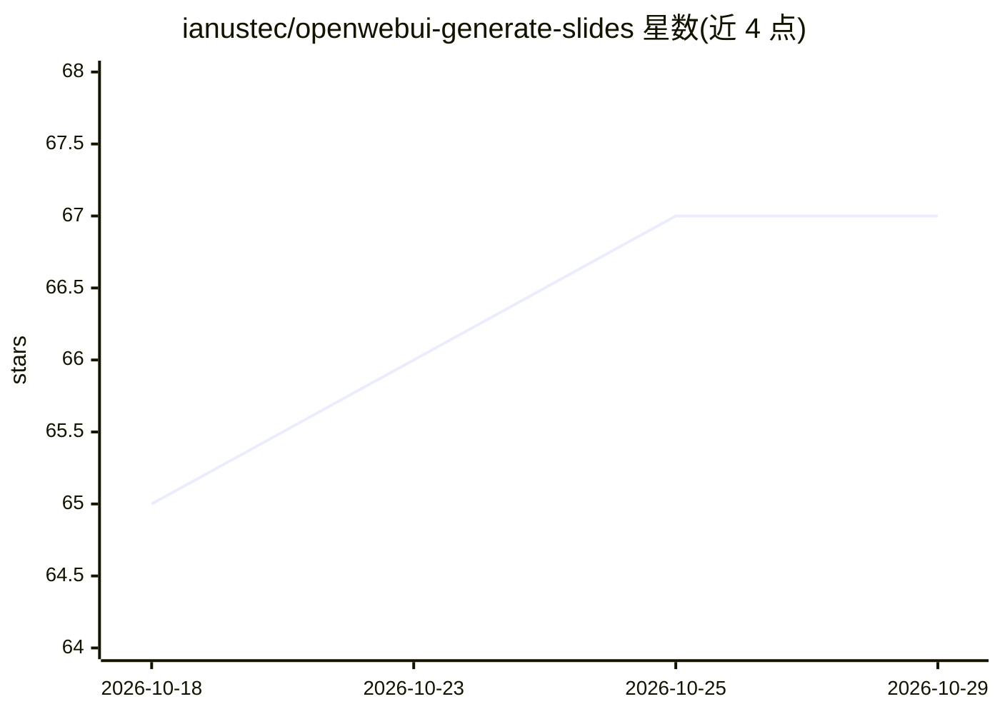

# ianustec/openwebui-generate-slides

⭐ 67 · Python · MIT · 推送 2026-10-05 · [GitHub](https://github.com/ianustec/openwebui-generate-slides) · [官网](https://ianustec.com) · 个人维护

**Open WebUI 工具：从模型生成的 JSON 规格生成原生 PPTX 演示文稿**

面向 Open WebUI 平台的 Tool 插件，形式为单文件 generate_slides.py。模型产出 JSON 规格后调用 generate_slides，引擎用 python-pptx 直接构建原生可编辑的 .pptx（含原生图表、约 25 种布局、主题系统、图标），不导出 HTML 或图片。文件经 Files API 保存并在聊天中返回下载链接。另含 inspect_slides（模板形状清单）与 edit_presentation（生成后小修），以及克隆用户模板的 Template Mode（默认经阀门关闭，需管理员开启）。依赖 python-pptx、pillow 由 Open WebUI 自动安装，要求 Open WebUI >= 0.4.0。

## 筛选速览

| 维度 | 判定 | 备注 |
|---|---|---|
| AI 角色 | `ai-ecosystem` | LLM/agent 周边工具 |
| 许可风险 | `permissive` | MIT |
| 部署形态 | `library` | 以包/库形式分发 |
| 模型依赖 | — | README 未给出锁定关系 |
| 硬件要求 | — | 无带数字的原话,不猜 |
| 安装摩擦 | `low` | 无编译、无系统依赖或容器化 |
| 成熟度 | `idea` | |

## 能力要点

- python-pptx 构建原生可编辑 .pptx，支持 7 种原生 Office 图表类型
- 约 25 种布局与 12 个命名主题（auto 可从内容推断）
- Template Mode 克隆用户 .pptx 模板并在安全区覆盖内容
- inspect_slides / edit_presentation 支持模板检视与生成后编辑（默认关闭，阀门控制）

## 适用场景

- 在自托管 Open WebUI 中通过对话生成品牌风格演示文稿
- 基于公司模板 .pptx 批量产出保持视觉样式的幻灯片
- 生成后在聊天中对已产出的 deck 做小范围修正

## 场景标签

`AI 写作` · 领域:内容生成

## 证据(README 行号)

> L5: A Open WebUI **Tool** that generates
> L56: The model calls `generate_slides(content)`, where `content` is a **single JSON string**.
> L197: 1. For a custom template, the model may call **`inspect_slides`** first, then **`generate_slides`** with the same 

## 星数曲线

2026-10-18 65 → 2026-10-29 67（+2）

---
*卡片 v1 · prompt 1.4 · 生成 2026-10-24 · 置信度 mid · 依据 README sha `8e8386b75a88` · [字段定义](../../DATASET.md)*
