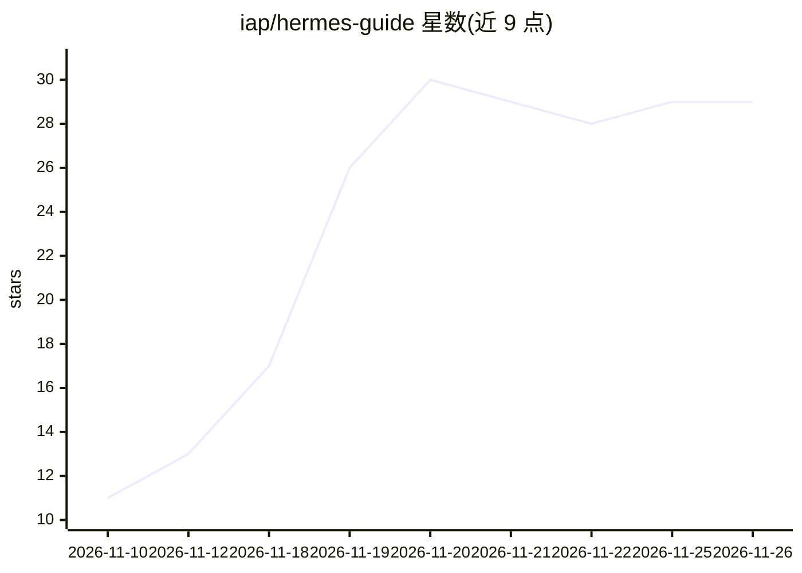

# iap/hermes-guide

⭐ 29 · Python · MIT · 推送 2026-11-25 · [GitHub](https://github.com/iap/hermes-guide) · 个人维护

**Hermes Agent 的自诊断插件与故障排查技能集**

面向不读 Hermes 源码的使用者与协助他们的会话：以只读插件形式提供覆盖 config/mcp/skills/hooks/plugins 等 12 个面的健康检查（/hermes-doctor 或 hermes guide，含 --json 与 --fast 模式，退出码区分 broken/unknown/healthy），另以 skills tap 形式分发 32 个排查技能（28 个 per-surface 诊断 playbook、安装与配置指南等），并注册一个路由技能把"出问题了"的报告导向对应 playbook。定位为补充而非替代 Hermes 内建诊断，全程只读、无自动修复；要求 Hermes >=0.21。

## 筛选速览

| 维度 | 判定 | 备注 |
|---|---|---|
| AI 角色 | `ai-ecosystem` | LLM/agent 周边工具 |
| 许可风险 | `permissive` | MIT |
| 部署形态 | `None` |  |
| 模型依赖 | — | README 未给出锁定关系 |
| 硬件要求 | — | 无带数字的原话,不猜 |
| 安装摩擦 | `medium` | 含编译或系统依赖之一 |
| 成熟度 | — | 结构信号不足 |

## 能力要点

- 12 个面的只读健康检查，退出码与 JSON 机器可读输出
- 32 个排查技能，含 28 个 per-surface 诊断 playbook 与 triage 路由技能
- findings 携带稳定 id/impact/fix，可被脚本解析
- 设计原则为补充内建诊断，发现重复时裁剪自身检查

## 适用场景

- Hermes Agent 出问题时先跑 hermes guide 定位是哪个面坏了
- 让会话通过路由技能自动匹配对应诊断 playbook
- 脚本化解析 JSON 诊断结果并按 id/fix 处理

## 场景标签

 · 领域:AI Agent 工具链/运维

## 证据(README 行号)

> L7: Hermes usage and self-diagnosis guide for Hermes Agent.
> L14: 1. **A plugin.** `/hermes-doctor` in a session, `hermes guide` in a terminal. Read-only health checks across

## 星数曲线

2026-11-10 11 → 2026-11-26 29（+18）

---
*卡片 v1 · prompt 1.4 · 生成 2026-11-18 · 置信度 high · 依据 README sha `a347f1c8785e` · [字段定义](../../DATASET.md)*
