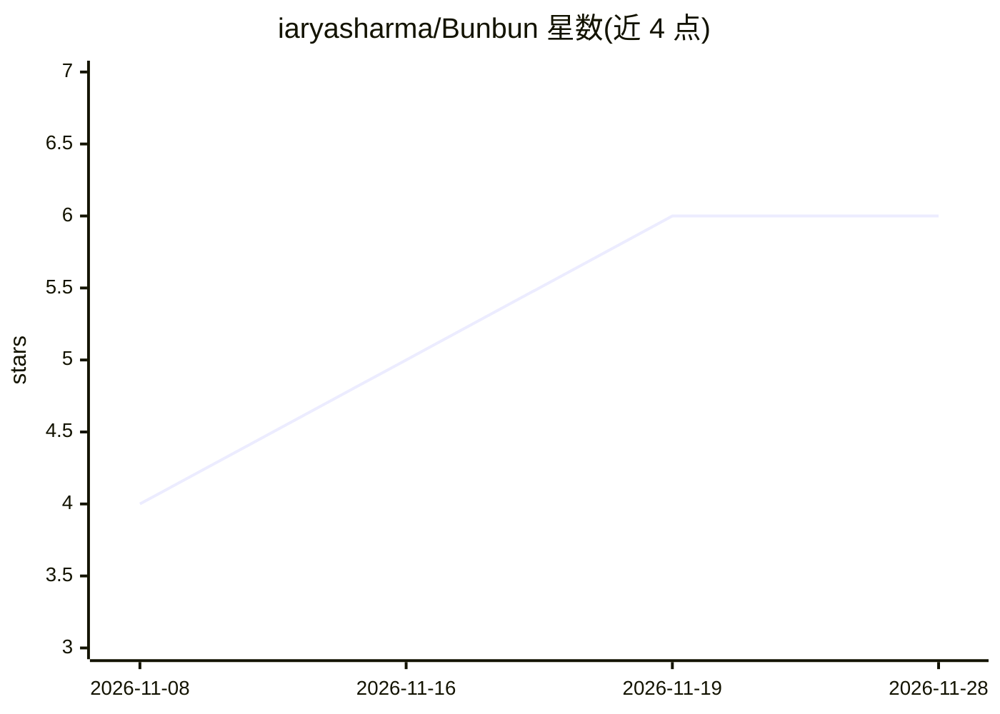

# iaryasharma/Bunbun

⭐ 6 · C++ · MIT · 推送 2026-11-18 · [GitHub](https://github.com/iaryasharma/Bunbun) · 个人维护

**Windows/Linux 灵动岛桌面工具，注视并代理你的编程 agent**

用 C++20 与 Direct2D 实现的原生屏幕灵动岛，显示音乐、日历、天气、系统状态、通知、计时器与文件架；连接 Claude Code、Antigravity、Cursor、Copilot 等编程 agent 后展示其运行状态，并对其权限请求提供一键 Allow/Deny，关闭时 agent 回退到自身窗口询问。空闲内存约 30 MB。安装包可选下载约 1.1 GB 本地语言模型供 Ask Bun 离线使用；Linux 版暂无 Ask Bun 与托盘图标。

## 筛选速览

| 维度 | 判定 | 备注 |
|---|---|---|
| AI 角色 | `ai-enhanced` | 去掉 AI 部分产品仍成立 |
| 许可风险 | `permissive` | MIT |
| 部署形态 | `desktop` | 安装包/桌面程序 |
| 模型依赖 | — | README 未给出锁定关系 |
| 硬件要求 | — | 无带数字的原话,不猜 |
| 安装摩擦 | `low` | 无编译、无系统依赖或容器化 |
| 成熟度 | — | 结构信号不足 |

## 能力要点

- 对编程 agent 权限请求的一键 Allow/Deny，关闭时回退至 agent 原生询问
- 支持 Claude Code、Antigravity、Cursor、GitHub Copilot 的接入与配置备份
- 可选本地离线语言模型（无账号、无密钥，用户自行下载模型）
- C++20 + Direct2D 原生实现，无 Electron

## 适用场景

- 运行多个编程 agent 时集中查看状态并快速审批权限
- 把音乐、日程、系统监控聚合到屏幕顶部的状态岛上
- 用 Ask Bun 命令行快捷操作音量、计时器、待办等系统功能

## 场景标签

 · 领域:桌面工具/效率

## 证据(README 行号)

> L5: **A native Dynamic Island for Windows and Linux, with a small bunny named Bun who keeps an eye on your coding agents
> L51: - Works with **Claude Code, Antigravity, Cursor and GitHub Copilot** (VS Code agent mode and CLI).
> L93: |**Local AI (optional)**|Turn on a small language model that runs offline on your PC. Bun then answers free-form qu

## 星数曲线

2026-11-08 4 → 2026-11-28 6（+2）

---
*卡片 v1 · prompt 1.4 · 生成 2026-11-20 · 置信度 high · 依据 README sha `270567cc6634` · [字段定义](../../DATASET.md)*
