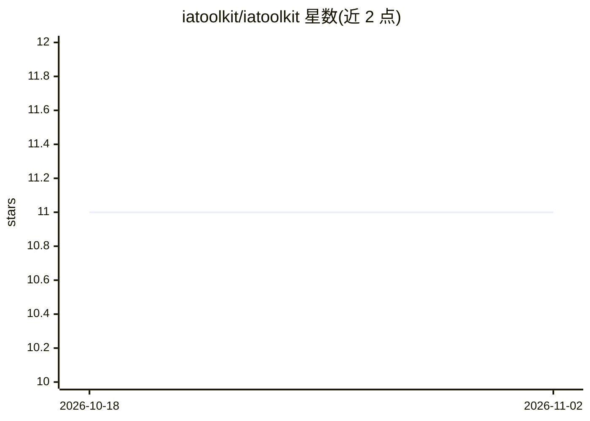

# iatoolkit/iatoolkit

⭐ 11 · Python · MIT · 推送 2026-10-31 · [GitHub](https://github.com/iatoolkit/iatoolkit) · [官网](https://www.iatoolkit.com) · 组织维护

**在企业私有环境构建多租户 AI 助手的开源框架**

面向生产环境 AI 助手的分层 Python 框架：将 LLM、SQL 数据、内部文档、工具与工作流整合进单一架构，包含接口层（Chat UI/REST API）、智能层（提示渲染、SQL 编排、RAG、工具分发）、执行层（Python 服务）与数据访问层（SQLAlchemy 仓库模式）。通过 Company 模块实现多租户隔离（每公司独立提示、工具、凭据、向量库）。采用 open-core 模式：社区版 MIT 许可含 SQL 与基础 RAG、单公司部署；企业版商业许可含多租户、SSO、支付集成，凭 License Key 激活。

## 筛选速览

| 维度 | 判定 | 备注 |
|---|---|---|
| AI 角色 | `ai-ecosystem` | LLM/agent 周边工具 |
| 许可风险 | `permissive` | MIT |
| 部署形态 | `None` |  |
| 模型依赖 | — | README 未给出锁定关系 |
| 硬件要求 | — | 无带数字的原话,不猜 |
| 安装摩擦 | `low` | 无编译、无系统依赖或容器化 |
| 成熟度 | — | 结构信号不足 |

## 能力要点

- SQL 编排、RAG 与工具执行整合于单一智能层
- Company 模块实现多租户隔离（提示/工具/凭据/文档）
- 自托管部署，运行于用户自有基础设施
- 社区版 MIT 许可（单公司），企业版商业许可（多租户/SSO）

## 适用场景

- 企业内部构建基于私有数据的对话助手
- SaaS 产品为多个客户同时提供 AI 助手
- 需要可复现提示与受控工具的 AI 团队搭建生产系统

## 场景标签

`Agent 框架` `RAG` · 领域:Agent 开发

## 证据(README 行号)

> L5: IAToolkit is not a demo wrapper or a prompt playground — it is a **full architecture** for implementing intelligent 
> L32: Core logic: prompt rendering, SQL orchestration, RAG, LLM tool dispatching.

## 星数曲线

2026-10-18 11 → 2026-11-02 11（+0）

---
*卡片 v1 · prompt 1.4 · 生成 2026-11-02 · 置信度 high · 依据 README sha `909a229cde85` · [字段定义](../../DATASET.md)*
