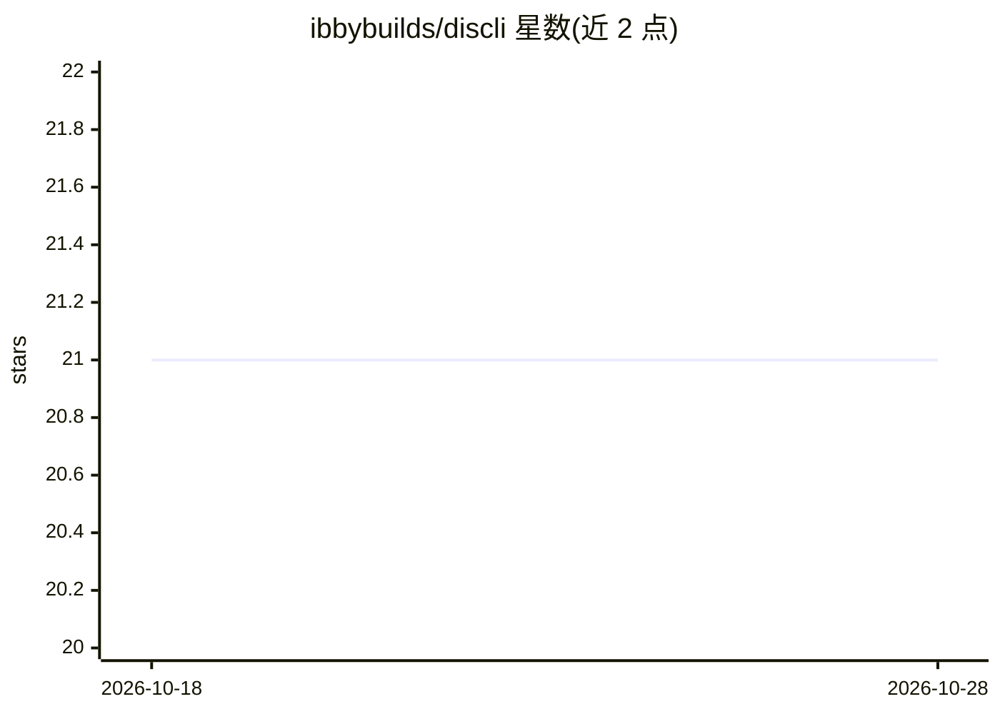

# ibbybuilds/discli

⭐ 22 · TypeScript · 推送 2026-03-16 · [GitHub](https://github.com/ibbybuilds/discli) · 个人维护

**供 AI 代理与人类使用的 Discord 服务器管理 CLI**

围绕 Discord REST API 的轻量命令行封装，一条命令对应一次 API 调用，无需运行 bot 服务器或 WebSocket 连接。功能覆盖频道、角色、权限、成员、消息、embed、文件上传、表情、邀请与审计日志管理，以 npm 全局安装或 npx 直接运行。面向 AI 代理（AIOS Companion、OpenClaw、Claude Code、Cursor、Codex）与人类用户设计：默认 YAML 输出以省 token，破坏性命令需 --confirm，支持 SOUL.md 定义 bot 人格；bot token 由用户自持、本地存储。

## 筛选速览

| 维度 | 判定 | 备注 |
|---|---|---|
| AI 角色 | `ai-enhanced` | 去掉 AI 部分产品仍成立 |
| 许可风险 | `none` | — |
| 部署形态 | `library` | 以包/库形式分发 |
| 模型依赖 | — | README 未给出锁定关系 |
| 硬件要求 | — | 无带数字的原话,不猜 |
| 安装摩擦 | `low` | 无编译、无系统依赖或容器化 |
| 成熟度 | — | 结构信号不足 |

## 能力要点

- 一条命令对应一次 Discord REST API 调用，无需 bot 服务器进程
- 频道/角色/权限/成员/消息/表情/邀请/审计日志全量管理命令
- 代理友好特性：YAML 默认输出、--dry-run、--confirm、结构化退出码、SCHEMA.md
- SOUL.md 定义 bot 人格，token 本地存储不自托管服务

## 适用场景

- 让 Claude Code/Cursor 等 AI 代理通过终端管理我的 Discord 服务器
- 用命令行批量创建频道、角色与权限，替代控制台手工操作
- 为社区 bot 设定统一人格与发言风格

## 场景标签

`工作流自动化` · 领域:效率与自动化

## 证据(README 行号)

> L3:  Discord server management CLI for AI agents and humans.
> L14: > Your AI agent (AIOS Companion, OpenClaw, Claude Code, Cursor, Codex) can use discli to manage your Discord server
> L148: discli is designed for AI agents like AIOS Companion, OpenClaw, Claude Code, Cursor, Codex, and others.
> L232: discli is not a bot. It's a thin CLI wrapper around the Discord REST API.

## 星数曲线

2026-10-18 21 → 2026-10-28 21（+0）

---
*卡片 v1 · prompt 1.4 · 生成 2026-10-28 · 置信度 high · 依据 README sha `94e05c08c434` · [字段定义](../../DATASET.md)*
