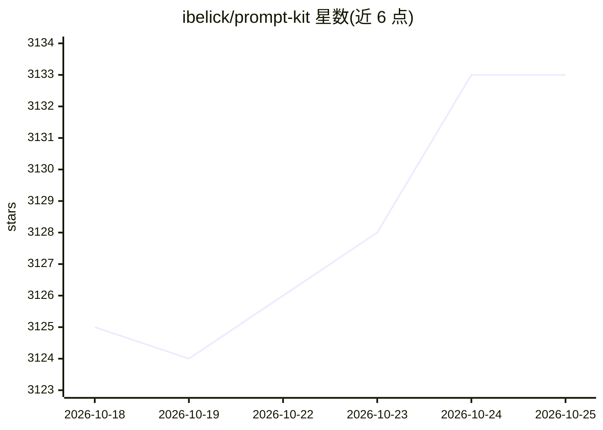

# ibelick/prompt-kit

⭐ 3,133 · TypeScript · MIT · 推送 2026-09-28 · [GitHub](https://github.com/ibelick/prompt-kit) · [官网](https://prompt-kit.com) · 个人维护

**面向 AI 应用的 React/shadcn UI 组件库**

基于 shadcn/ui 与 Tailwind CSS 的 React 组件库，提供构建聊天界面、AI agent、自主助手等 AI 应用所需的界面组件（如 PromptInput 输入框）。安装依赖前置的 shadcn/ui 配置，通过 shadcn CLI 以 npx 命令按需添加组件，安装后以 import 方式在项目中使用。面向使用 Next.js/React 技术栈的前端与全栈开发者。

## 筛选速览

| 维度 | 判定 | 备注 |
|---|---|---|
| AI 角色 | `ai-ecosystem` | LLM/agent 周边工具 |
| 许可风险 | `permissive` | MIT |
| 部署形态 | `library` | 以包/库形式分发 |
| 模型依赖 | — | README 未给出锁定关系 |
| 硬件要求 | — | 无带数字的原话,不猜 |
| 安装摩擦 | `low` | 无编译、无系统依赖或容器化 |
| 成熟度 | — | 结构信号不足 |

## 能力要点

- 提供 AI 聊天与 agent 界面的可定制组件
- 基于 shadcn/ui 体系，通过 shadcn CLI 按需安装
- 组件支持 import 直接集成到 React 项目

## 适用场景

- 快速搭建 AI 聊天应用的界面
- 为 AI agent 或助手产品构建前端组件
- 在已有 shadcn/ui 项目中补充 AI 交互组件

## 场景标签

 · 领域:前端/UI 组件

## 证据(README 行号)

> L3: **Customizable, high-quality components for AI applications.**
> L4: Build chat experiences, AI agents, autonomous assistants, and more, quickly and beautifully.

## 星数曲线

2026-10-18 3,125 → 2026-10-25 3,133（+8）

---
*卡片 v1 · prompt 1.4 · 生成 2026-10-20 · 置信度 high · 依据 README sha `f2c039cf1c8b` · [字段定义](../../DATASET.md)*
