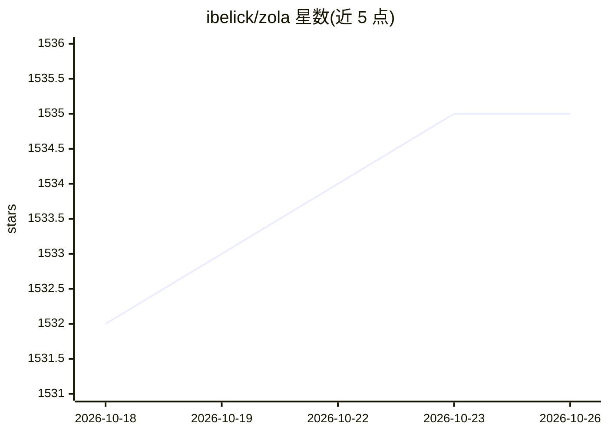

# ibelick/zola

⭐ 1,535 · TypeScript · Apache-2.0 · 推送 2025-12-11 · [GitHub](https://github.com/ibelick/zola) · [官网](https://zola.chat) · 个人维护

**开源多模型聊天界面，支持云端与本地 Ollama 模型**

基于 Next.js 的开源自托管 Web 聊天界面，面向使用多种 LLM 的用户：支持 OpenAI、Mistral、Claude、Gemini 及本地 Ollama 模型，自动检测本地模型；通过 OpenRouter 提供自带 API key（BYOK）接入。功能含文件上传、自定义系统提示词、多种布局、亮暗主题与 MCP 支持（标注 wip）。技术栈为 Tailwind CSS、shadcn/ui、prompt-kit、Vercel AI SDK、Supabase（认证与存储）。提供源码运行与 Docker Compose 部署方式，自述为 beta 版本，代码可能变动。

## 筛选速览

| 维度 | 判定 | 备注 |
|---|---|---|
| AI 角色 | `ai-native` | 本体是模型或模型工具 |
| 许可风险 | `permissive` | Apache-2.0 |
| 部署形态 | `library` | 以包/库形式分发 |
| 模型依赖 | local-ok | 支持本地模型 |
| 硬件要求 | — | 无带数字的原话,不猜 |
| 安装摩擦 | `low` | 无编译、无系统依赖或容器化 |
| 成熟度 | `idea` | |

## 能力要点

- 多模型支持：OpenAI、Mistral、Claude、Gemini 与本地 Ollama（自动模型检测）
- 通过 OpenRouter 的 BYOK 接入
- 文件上传、自定义系统提示词、多布局选项
- 自托管：源码运行、Docker Compose、Vercel 部署

## 适用场景

- 在一个界面中切换使用多家云端模型与本地 Ollama 模型
- 用自有 API key 自托管聊天界面
- 本地运行模型并自动检测可用模型进行对话

## 场景标签

`聊天机器人` · 领域:对话与助手

## 证据(README 行号)

> L5: **Zola** is the open-source chat interface for all your models.
> L11: - Multi-model support: OpenAI, Mistral, Claude, Gemini, Ollama (local models)
> L18: - Local AI with Ollama: Run models locally with automatic model detection

## 星数曲线

2026-10-18 1,532 → 2026-10-26 1,535（+3）

---
*卡片 v1 · prompt 1.4 · 生成 2026-10-21 · 置信度 high · 依据 README sha `c95445d8a6a6` · [字段定义](../../DATASET.md)*
