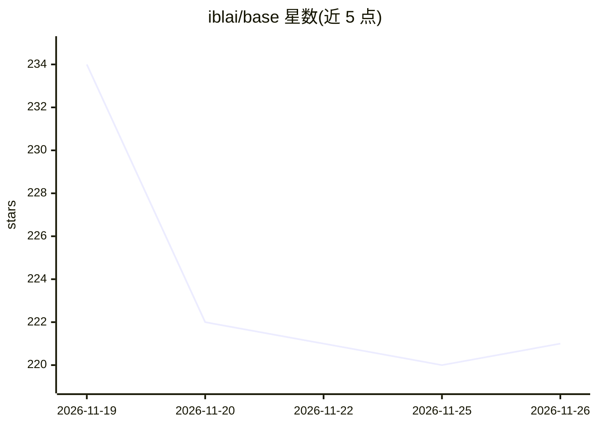

# iblai/base

⭐ 221 · Rust · MIT · 推送 2026-11-25 · [GitHub](https://github.com/iblai/base) · [官网](https://ibl.ai/join) · 组织维护

**ibl.ai 平台的 vibe coding 技能包：快速搭建 AI 应用**

面向在 ibl.ai 托管平台上构建应用的工具集：通过 npx 安装技能到 Claude Code、Codex、Cursor 等编码代理，脚手架生成含 SSO 登录、AI 聊天、用户/管理员、自定义数据、记忆、分析、计费的 Next.js 应用。技能分 iblai-vibe-*（UI 组件）与 iblai-api-*（REST 无头）两族，覆盖 start/agents/users/organizations/billing/monetization/analytics/content/ship/security 十个目录。默认连接托管环境，本地自托管平台代码需另行联系获取许可。

## 筛选速览

| 维度 | 判定 | 备注 |
|---|---|---|
| AI 角色 | `ai-ecosystem` | LLM/agent 周边工具 |
| 许可风险 | `permissive` | MIT |
| 部署形态 | `library` | 以包/库形式分发 |
| 模型依赖 | — | README 未给出锁定关系 |
| 硬件要求 | — | 无带数字的原话,不猜 |
| 安装摩擦 | `low` | 无编译、无系统依赖或容器化 |
| 成熟度 | — | 结构信号不足 |

## 能力要点

- npx 一条命令安装技能到多种编码代理（Claude Code/Codex/Cursor/Copilot）
- 两族技能：iblai-vibe-* 挂载 UI 组件，iblai-api-* 经 REST 无头调用
- vibe-starter 脚手架开箱提供登录、聊天、管理区、记忆、分析、计费
- 部署命令生成 URL，并可构建 macOS/Windows/iOS/Android 原生应用

## 适用场景

- 在 ibl.ai 平台上从零生成一个带登录与 AI 聊天的 Next.js 应用
- 给已有应用按需添加用户资料、记忆、分析、计费等模块技能
- 为脚本或 CI 任务用 REST 技能无头调用平台功能

## 场景标签

`代码生成` · 领域:编码与开发

## 证据(README 行号)

> L5: Ship AI-powered apps fast — and run the platform behind them. Backend included.
> L27: **1. Install the skills** in the agent you already use.
> L30: npx skills add iblai/base --all        # Claude Code, OpenAI Codex, Cursor, OpenCode, Copilot …
> L89: Two families in one install: **🖥️ `iblai-vibe-*`** mounts a visual component in

## 星数曲线

2026-11-19 234 → 2026-11-26 221（-13）

---
*卡片 v1 · prompt 1.4 · 生成 2026-11-26 · 置信度 high · 依据 README sha `ed823bb3ea43` · [字段定义](../../DATASET.md)*
