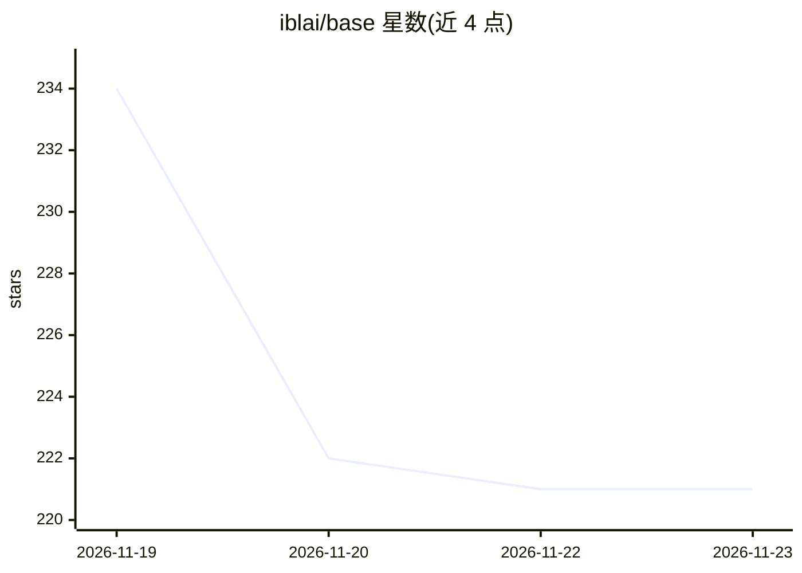

# iblai/base

⭐ 221 · Rust · MIT · 推送 2026-11-21 · [GitHub](https://github.com/iblai/base) · [官网](https://ibl.ai/join) · 组织维护

**在 ibl.ai 平台上快速搭建 AI 应用的开发者工具包**

ibl.ai 官方提供的脚手架工具包：通过 npx 安装一组 Claude Code / Codex / Cursor 等编码代理可用的 skills，由代理生成基于 Next.js + TypeScript + Tailwind 的应用，内置 SSO 登录、agent 聊天、用户画像、通知、分析等页面，配套 @iblai/iblai-js SDK 与托管后端（iblai.app）。另提供 8 个安全审计类 skills、MCP 文档服务器，支持 Tauri 打包桌面与移动端。运行依赖托管环境，本地/自托管平台代码需另行联系获取许可。

## 筛选速览

| 维度 | 判定 | 备注 |
|---|---|---|
| AI 角色 | `ai-ecosystem` | LLM/agent 周边工具 |
| 许可风险 | `permissive` | MIT |
| 部署形态 | `library` | 以包/库形式分发 |
| 模型依赖 | local-ok | 支持本地模型 |
| 硬件要求 | — | 无带数字的原话,不猜 |
| 安装摩擦 | `low` | 无编译、无系统依赖或容器化 |
| 成熟度 | — | 结构信号不足 |

## 能力要点

- 30+ 个编码代理 skills：连接组织、认证、agent 聊天、工作流编辑器、RBAC 等按需添加
- 支持 Claude Code、OpenAI Codex、Cursor、Copilot 等多种编码代理
- @iblai/mcp MCP 服务器提供组件/Hook/API 文档查询与页面模板生成
- Tauri 构建桌面（macOS/Windows/Linux）与移动端（iOS/Android）应用

## 适用场景

- 用编码代理从零生成带登录和 AI 聊天的 Next.js 应用
- 为已有项目逐步添加 agent 管理界面与分析仪表盘
- 将 AI 应用打包为桌面或移动端分发

## 场景标签

`代码生成` · 领域:编码与开发

## 证据(README 行号)

> L5: Ship AI-powered apps fast — and run the platform behind them. Backend included.
> L27: **1. Install the skills** in the agent you already use.
> L48: - `/iblai-vibe-connect` -- connects the project to an ibl.ai organization via a one-click browser flow, writing the

## 星数曲线

2026-11-19 234 → 2026-11-23 221（-13）

---
*卡片 v1 · prompt 1.4 · 生成 2026-11-19 · 置信度 high · 依据 README sha `615c72c4e119` · [字段定义](../../DATASET.md)*
