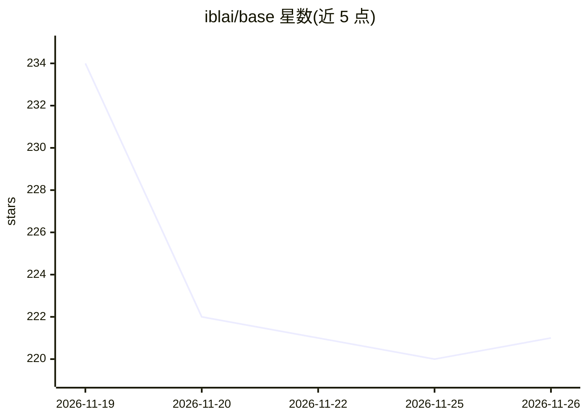

# iblai/base

⭐ 221 · Rust · MIT · 推送 2026-11-25 · [GitHub](https://github.com/iblai/base) · [官网](https://ibl.ai/join) · 组织维护

**面向开发者的 ibl.ai 平台 AI 应用脚手架工具包**

面向 vibe coding 场景的开发者工具包：通过 npx skills 命令向 Claude Code、OpenAI Codex、Cursor、Copilot 等 agent 安装一组技能，用 @iblai/iblai-js SDK 生成带 SSO 登录、AI agent 聊天、用户/组织管理、通知与分析的 Next.js 应用，支持 Tauri 打包为 macOS/Windows/iOS/Android 应用。运行依赖托管在 iblai.app 的后端环境；本地或自托管完整平台代码需另行联系获取许可。

## 筛选速览

| 维度 | 判定 | 备注 |
|---|---|---|
| AI 角色 | `ai-ecosystem` | LLM/agent 周边工具 |
| 许可风险 | `permissive` | MIT |
| 部署形态 | `library` | 以包/库形式分发 |
| 模型依赖 | local-ok | 支持本地模型 |
| 硬件要求 | — | 无带数字的原话,不猜 |
| 安装摩擦 | `low` | 无编译、无系统依赖或容器化 |
| 成熟度 | — | 结构信号不足 |

## 能力要点

- npx skills add 一条命令为多种编码 agent 安装技能
- 约 30 个技能覆盖登录、agent 聊天、工作流、分析、RBAC 等界面与功能
- 提供 SDK 文档 MCP 服务器与组件/ hook 查询接口
- 支持 Tauri 桌面与移动端构建，含本地 LLM（Ollama/Foundry）集成契约

## 适用场景

- 在 ibl.ai 平台上快速搭一个带 agent 聊天与计费分析的 SaaS 应用
- 用已有的 Claude Code/Cursor 工作流生成完整前后端工程
- 构建可分发的 Tauri 桌面端并接入设备端本地模型

## 场景标签

`代码生成` · 领域:编码与开发

## 证据(README 行号)

> L5: Ship AI-powered apps fast — and run the platform behind them. Backend included.
> L27: **1. Install the skills** in the agent you already use.
> L58: - `/iblai-vibe-local-llm` -- defines the contract for adding on-device LLM inference (Ollama / Foundry) to a Tauri 

## 星数曲线

2026-11-19 234 → 2026-11-26 221（-13）

---
*卡片 v1 · prompt 1.4 · 生成 2026-11-25 · 置信度 high · 依据 README sha `5ed5f2237bac` · [字段定义](../../DATASET.md)*
