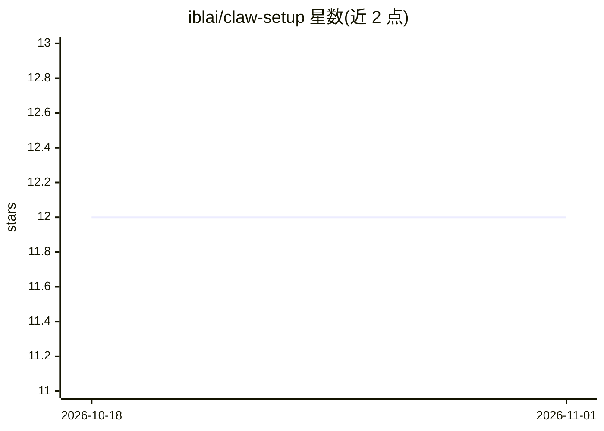

# iblai/claw-setup

⭐ 12 · Shell · MIT · 推送 2026-09-16 · [GitHub](https://github.com/iblai/claw-setup) · [官网](https://ibl.ai) · 组织维护

**将自托管 OpenClaw/NemoClaw 服务器接入 ibl.ai 平台的部署指南与脚本**

ibl.ai 维护的仓库，提供在 Debian/Ubuntu VPS 上部署 OpenClaw 或 NVIDIA NemoClaw 的 install.sh 脚本与分步指南：自动配置 Caddy TLS、防火墙、systemd 与平台扩展插件，并生成网关令牌与 Ed25519 设备密钥，将实例注册到 ibl.ai。接入后可通过 ibl.ai API 集中管理 agent 身份、技能与多模型（Anthropic/OpenRouter/OpenAI 兼容）配置，计算在用户自有服务器上运行。也提供受限主机（无 root、仅代理出站）下的 NemoClaw 部署路径。

## 筛选速览

| 维度 | 判定 | 备注 |
|---|---|---|
| AI 角色 | `ai-ecosystem` | LLM/agent 周边工具 |
| 许可风险 | `permissive` | MIT |
| 部署形态 | `None` |  |
| 模型依赖 | — | README 未给出锁定关系 |
| 硬件要求 | — | 无带数字的原话,不猜 |
| 安装摩擦 | `low` | 无编译、无系统依赖或容器化 |
| 成熟度 | — | 结构信号不足 |

## 能力要点

- install.sh 一键部署 OpenClaw/NemoClaw + Caddy TLS + 防火墙 + systemd
- Ed25519 设备身份签名与令牌认证，重复运行不重置密钥
- 通过 ibl.ai API 集中管理 mentor、技能与多 agent 部署
- 支持 Anthropic/OpenRouter/OpenAI 兼容提供商及自动回退

## 适用场景

- 在自己的 VPS 上运行 AI agent 并通过 ibl.ai 平台管理
- 教育或机构场景下集中配置多个 mentor agent
- 受限主机（无 root/仅代理出站）环境部署 NemoClaw

## 场景标签

 · 领域:AI agent 基础设施/部署

## 证据(README 行号)

> L5: Connect self-hosted claw servers (OpenClaw, NVIDIA NemoClaw) to the ibl.ai platform. Run your own AI agent infrastru
> L42: Once connected, your claw instance is accessible from all ibl.ai applications -- Mentor AI, Skills AI, and any cust

## 星数曲线

2026-10-18 12 → 2026-11-01 12（+0）

---
*卡片 v1 · prompt 1.4 · 生成 2026-11-01 · 置信度 high · 依据 README sha `6b000f70da3a` · [字段定义](../../DATASET.md)*
