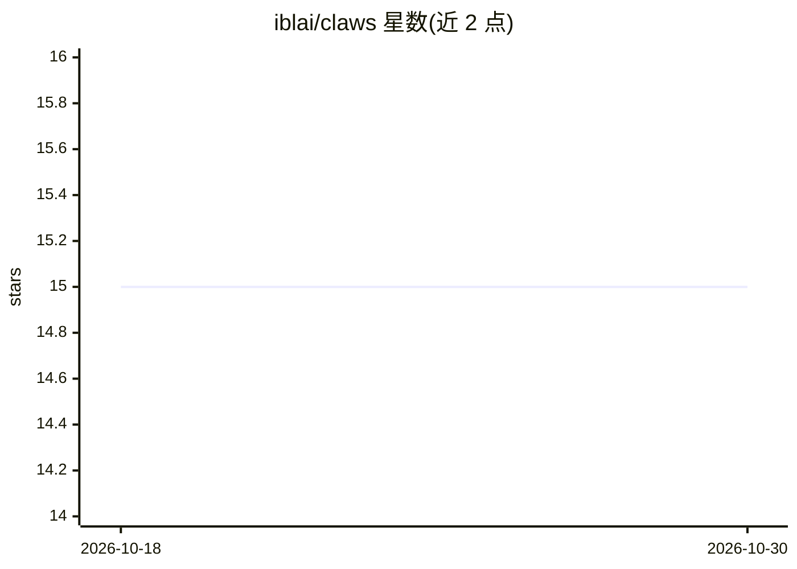

# iblai/claws

⭐ 15 · MIT · 推送 2026-06-08 · [GitHub](https://github.com/iblai/claws) · [官网](https://ibl.ai) · 组织维护

**面向 7 个行业领域的 OpenClaw/NemoClaw 多智能体配置仓库**

ibl.ai 维护的纯配置仓库：以 git submodule 聚合 7 个行业分部（高教、K-12、企业、政府、法律、金融、医疗）的 agent 配置，共 95 个 agent（7 个父编排器 + 88 个专家子代理）和 76 个工具技能。每个分部含 openclaw.json 网关配置，复制到 OpenClaw/NemoClaw 主机的配置根目录、重算哈希并重载网关即可导入；父代理通过 sessions_spawn 分派给子代理。仓库无应用代码、构建系统或测试，部署前需替换占位 API 凭据。

## 筛选速览

| 维度 | 判定 | 备注 |
|---|---|---|
| AI 角色 | `ai-ecosystem` | LLM/agent 周边工具 |
| 许可风险 | `permissive` | MIT |
| 部署形态 | `None` |  |
| 模型依赖 | — | README 未给出锁定关系 |
| 硬件要求 | — | 无带数字的原话,不猜 |
| 安装摩擦 | `low` | 无编译、无系统依赖或容器化 |
| 成熟度 | — | 结构信号不足 |

## 能力要点

- 7 个行业分部共 95 个 agent 与 76 个工具技能
- 零转换导入 OpenClaw/NemoClaw 主机（复制配置 + 重算哈希 + 重载网关）
- 父代理经 sessions_spawn 按需分派专家子代理并汇总结果
- 提供可粘贴给 Claude Code 的分部安装 runbook

## 适用场景

- 为教育、医疗、金融等行业部署预置的多智能体助手系统
- 在已有 OpenClaw/NemoClaw 主机上按分部导入整套 agent 配置
- 参考现有分部结构添加新 agent 或新行业分部

## 场景标签

`多智能体` · 领域:Agent 开发

## 证据(README 行号)

> L14: This repository contains **7 segment configurations**, one for each segment in the ibl.ai Solutions menu. Each segm
> L26: **95 agents** (7 parents + 88 specialists) and **76 tool skills** in total. This is a configuration-only repository
> L41: The repo contains **only what the OpenClaw/NemoClaw runtime actually loads** — the per-agent files above plus `open

## 星数曲线

2026-10-18 15 → 2026-10-30 15（+0）

---
*卡片 v1 · prompt 1.4 · 生成 2026-10-30 · 置信度 high · 依据 README sha `4613dcb49544` · [字段定义](../../DATASET.md)*
