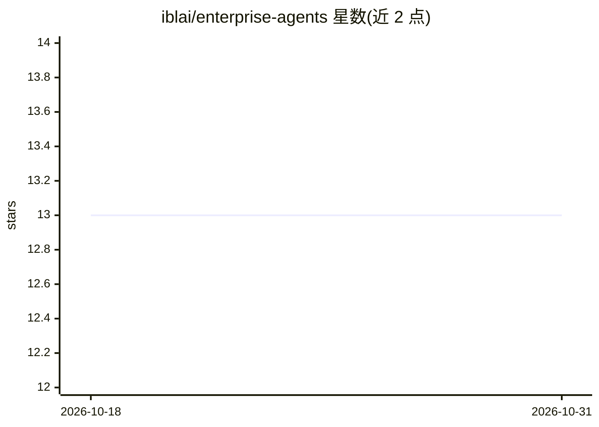

# iblai/enterprise-agents

⭐ 13 · MIT · 推送 2026-06-08 · [GitHub](https://github.com/iblai/enterprise-agents) · [官网](https://ibl.ai/solutions/enterprise) · 组织维护

**ibl.ai 企业场景的 OpenClaw/NemoClaw 多 agent 配置包**

面向 ibl.ai Enterprise 方案的开箱即用 agent 配置：1 个 Workplace Assistant 编排入口加 12 个职能子 agent（知识搜索、IT 支持、HR、销售、客服、数据分析等）。父 agent 通过 AGENTS.md 路由表解析意图并经 sessions_spawn 分发任务，跨域请求并行生成子 agent 后合成回复。集成 12 个第三方平台（Salesforce、Jira、Okta 等），需在 sandbox 主机上复制配置、填入 Anthropic API key 与各平台凭证、重算配置哈希并重载 OpenClaw 网关。默认模型为 claude-sonnet-4-5。

## 筛选速览

| 维度 | 判定 | 备注 |
|---|---|---|
| AI 角色 | `ai-ecosystem` | LLM/agent 周边工具 |
| 许可风险 | `permissive` | MIT |
| 部署形态 | `None` |  |
| 模型依赖 | locked-api |  |
| 硬件要求 | — | 无带数字的原话,不猜 |
| 安装摩擦 | `low` | 无编译、无系统依赖或容器化 |
| 成熟度 | — | 结构信号不足 |

## 能力要点

- 1 个编排入口 + 12 个职能子 agent 的完整配置
- 12 个企业平台集成技能（Confluence/GitHub/Salesforce/Jira/Okta/Snowflake 等）
- 跨域请求并行生成多个子 agent 并合成单一回复
- 提供 NemoClaw 沙箱主机的七步导入部署流程

## 适用场景

- 为企业员工提供统一的职场问答与任务办理入口
- 让 agent 读写 Confluence/Jira/Salesforce 等内部系统
- 在企业内落地 IT 服务台、HR、入职等职能自动化

## 场景标签

`多智能体` `AI 助手` · 领域:Agent 开发

## 证据(README 行号)

> L5: Drop-in OpenClaw / NemoClaw agent configuration for the ibl.ai **Enterprise** solution segment — one Workplace Assis
> L52: The parent agent (`enterprise-assistant`) receives all incoming employee messages. It interprets intent using its `

## 星数曲线

2026-10-18 13 → 2026-10-31 13（+0）

---
*卡片 v1 · prompt 1.4 · 生成 2026-10-31 · 置信度 high · 依据 README sha `d37c68aabea2` · [字段定义](../../DATASET.md)*
